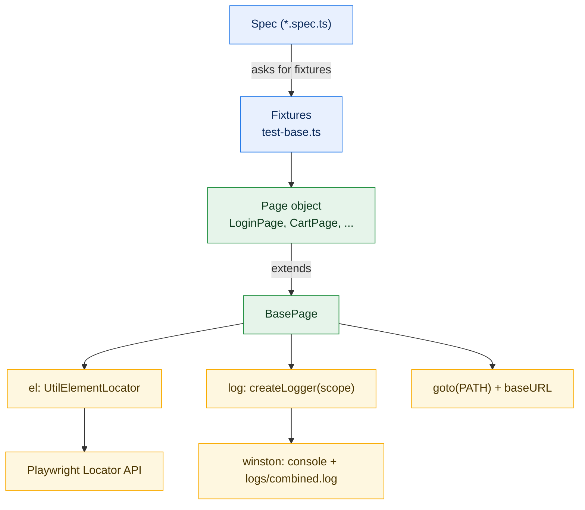
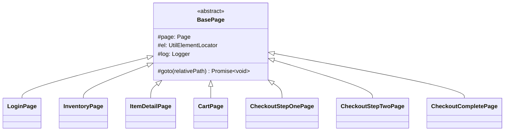
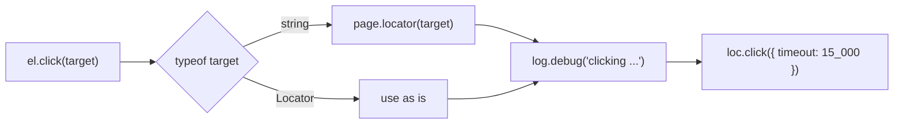
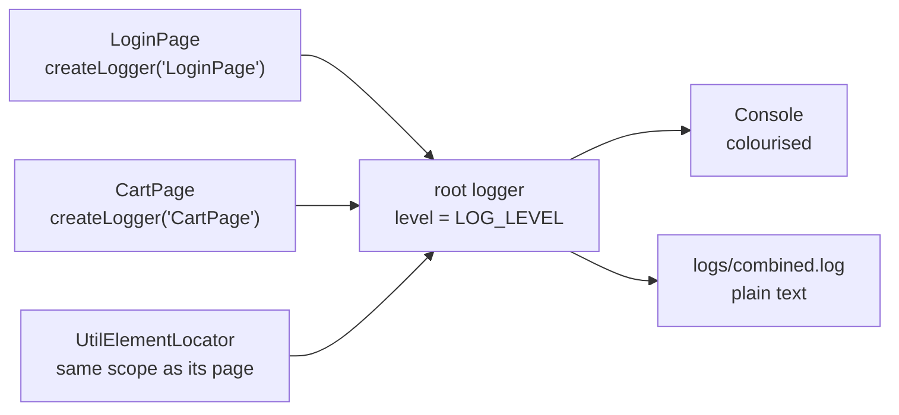
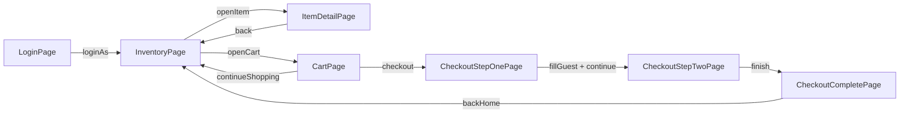
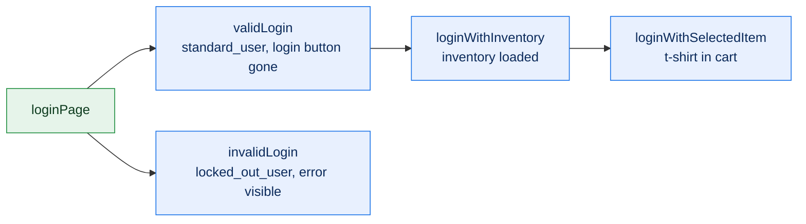
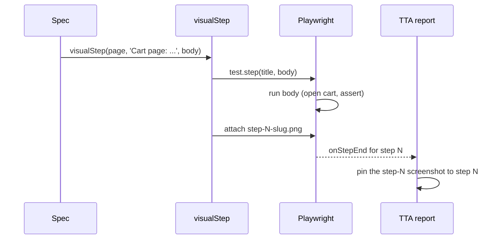
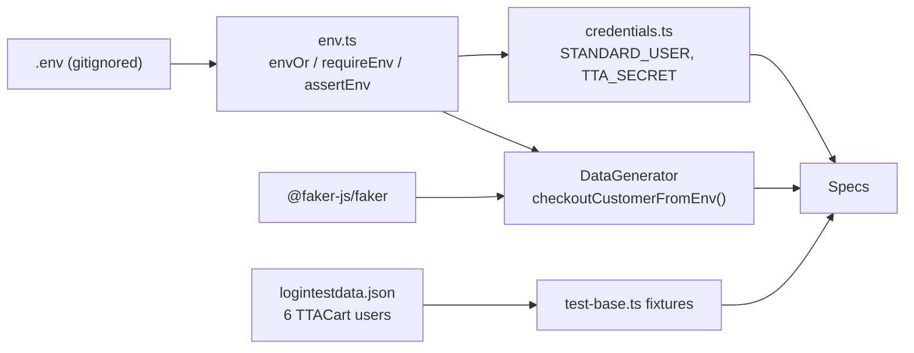

# Advance Playwright Framework 3x

An end-to-end test automation framework built on **Playwright + TypeScript**, using the Page Object Model, environment-based configuration, data-driven test utilities, and a custom HTML reporter (the TTA report) with screenshots, videos and traces for every step.

Built by [The Testing Academy](https://thetestingacademy.com).

## Tech stack

| Area | Tool |
|---|---|
| Test runner | `@playwright/test` 1.64 |
| Language | TypeScript |
| Config | `dotenv` (`.env` file) |
| Logging | `winston` (console + `logs/combined.log`) |
| Reporting | TTA custom reporter, Playwright HTML report |
| Test data | CSV, YAML, Excel (`exceljs`), MySQL (`mysql2`), `@faker-js/faker` |
| CI | GitHub Actions |

## Folder structure

```
AdvancePlaywrightFramework3x
├── src/
│   ├── ai/          → AI helpers used by the TTA report (RCA, flaky analysis)
│   ├── api/         → API clients
│   ├── config/      → env.ts (reads .env), credentials.ts (TTACart login)
│   ├── fixtures/    → test-base.ts: page-object and login-state fixtures
│   ├── pages/       → BasePage + 7 TTACart page objects (login to checkout complete)
│   ├── testdata/    → Test data files (logintestdata.json: the six TTACart users)
│   ├── tests/       → Test cases (*.spec.ts), e2e/ for full checkout journeys
│   └── utils/       → UtilElementLocator, logger, reporter, DataGenerator, visualSteps, data readers
├── docs/
├── rules/
├── learnings/       → Notes on non-obvious problems and how they were solved
├── .github/         → CI workflow
├── .env.example     → Template for your local .env
├── package.json
├── playwright.config.ts
└── tsconfig.json
```

## Getting started

Prerequisites: Node.js 20 or newer.

```bash
git clone https://github.com/PramodDutta/AdvancePlaywrightFramework3x.git
cd AdvancePlaywrightFramework3x

npm ci                         # install dependencies
npx playwright install         # download browsers
cp .env.example .env           # then edit .env with your values

npx playwright test            # run the suite
```

## Running tests

```bash
npx playwright test                          # all tests
npx playwright test src/tests/login.spec.ts  # one file
npx playwright test -g "valid credns"        # by test title
npx playwright test --ui                     # interactive UI mode
npx playwright test --debug                  # step through with the inspector

ATTACH_SCREENSHOTS=true npx playwright test src/tests/e2e   # e2e specs with step screenshots
```

The e2e specs in [src/tests/e2e/](src/tests/e2e/) all run the same TTACart checkout, each showing a different technique:

| Spec | Shows |
|---|---|
| [e2e-checkout.spec.ts](src/tests/e2e/e2e-checkout.spec.ts) | Page-object fixtures, login in `beforeEach` |
| [e2e-checkout-with-visualStep.spec.ts](src/tests/e2e/e2e-checkout-with-visualStep.spec.ts) | One `visualStep` per page, login included |
| [e2e-checkout_validFixture.spec.ts](src/tests/e2e/e2e-checkout_validFixture.spec.ts) | `validLogin` and `invalidLogin` state fixtures |
| [e2e-checkout_validFixture_PonyTail_Review.spec.ts](src/tests/e2e/e2e-checkout_validFixture_PonyTail_Review.spec.ts) | The validFixture spec after a readability pass |

Default run settings (see [playwright.config.ts](playwright.config.ts)):

- **Browser:** Chromium at a 1920x1080 viewport. Firefox and WebKit projects are in the config, commented out.
- **Headed locally, headless on CI.** `headless: !!process.env.CI` shows the browser on your machine and keeps CI runners (which have no display) headless.
- **Media on every test:** screenshot, video and trace are all `'on'` so the report always has something to show. For a large suite, switch to `'only-on-failure'` / `'retain-on-failure'`.
- **On CI:** 2 retries, 1 worker, and `test.only` fails the build.

## Environments

The base URL is picked in `resolveBaseURL()` in the config:

1. If `BASE_URL` is set, it is used as is.
2. Otherwise `TTA_ENV` selects one of the URLs below (default `qa`).

| `TTA_ENV` | Uses |
|---|---|
| `qa` (default) | `QA_BASE_URL` |
| `stg`, `stage`, `staging` | `STG_BASE_URL` |
| `prod`, `production` | `PROD_BASE_URL` |
| `dev`, `local` | `DEV_BASE_URL` |
| `api` | `API_BASE_URL` |

To switch environments, leave `BASE_URL` empty and run, for example:

```bash
TTA_ENV=stg npx playwright test
```

### Environment variables

| Variable | Used for |
|---|---|
| `TTA_ENV`, `BASE_URL`, `*_BASE_URL` | Base URL selection (above) |
| `TEST_ENV`, `TEST_AUTHOR` | Shown in the TTA report header |
| `STANDARD_USER`, `TTA_SECRET` | TTACart login in [credentials.ts](src/config/credentials.ts); blank uses `standard_user` / `tta_secret` |
| `ATTACH_SCREENSHOTS` | `true` attaches a screenshot to every `visualStep()` |
| `CHECKOUT_FIRST_NAME`, `CHECKOUT_LAST_NAME`, `CHECKOUT_POSTAL_CODE` | Optional fixed customer for `DataGenerator.checkoutCustomerFromEnv()` |
| `LOG_LEVEL` | Logging verbosity |
| `ANTHROPIC_API_KEY` / `OPENAI_API_KEY` / `GOOGLE_API_KEY` | Optional, enables the AI Verdict tab |
| `MYSQL_HOST`, `MYSQL_PORT`, `MYSQL_USER`, `MYSQL_PASSWORD`, `MYSQL_DATABASE` | Optional, MySQL data-driven tests |

> **Why `STANDARD_USER` and not `USERNAME`:** Windows always sets `USERNAME` to your login name, and dotenv does not overwrite variables that already exist, so a `USERNAME` in `.env` is silently ignored on Windows.

`.env` is gitignored. Never commit real credentials.

## Reports

### TTA custom report

Generated by [src/utils/CustomReporter.ts](src/utils/CustomReporter.ts) on every run.

```bash
open tta-report/index.html        # macOS: latest run
start tta-report/index.html       # Windows
```

- `tta-report/index.html` always opens the **latest** run. `history.html` lists earlier runs.
- Each test shows its steps, logs, screenshots, video and a downloadable trace.
- The report refreshes itself every 5 seconds while tests are running.
- **Flaky tab:** compares this run with the previous one (snapshots in `reports/runs/`), so it appears from the second run onwards.
- **AI Verdict tab:** root-cause hints for failed tests, enabled when one of the AI API keys is set. The agent in [src/ai/agents/rcaAgent.ts](src/ai/agents/rcaAgent.ts) is currently heuristic; swap in a real LLM call when ready.

### Playwright HTML report

```bash
npx playwright show-report
```

### Trace viewer

```bash
npx playwright show-trace tta-report/traces/trace_1.zip
```

## Framework layers

A spec asks [test-base.ts](src/fixtures/test-base.ts) for the page objects it needs, or for a ready state such as a logged-in user. Every page object extends `BasePage`, which gives it an action wrapper (`el`), a scoped logger (`log`) and a `goto()` that resolves against `baseURL`.



### 01: BasePage

**Concept:** [BasePage](src/pages/BasePage.ts) is the abstract parent of every TTACart page object. It gives each subclass the `page`, an `el` action wrapper, a `log` tagged with the page's name, and a `goto(path)` helper that navigates relative to `baseURL`.

**Why:** Without it, every page object repeats the same constructor wiring and hard-codes full URLs, so switching environments means editing every page.

**Q&A: why use this?**
- **Q: Why doesn't BasePage build any locators?** A: Each page owns its own `private readonly` locators. The base class carries only plumbing, so it never grows into a god object.
- **Q: Why is `goto()` protected?** A: Specs call the page's `open()`, which goes to the page's static `PATH` and then runs `assertLoaded()`. Specs never pass raw URLs.
- **Q: What's the gotcha?** A: The `scope` string passed to `super(page, 'CartPage')` is what every log line is tagged with. Copy-paste a page and forget to change it, and the logs point at the wrong page.



```ts
// src/pages/BasePage.ts
export abstract class BasePage {
    protected readonly page: Page;
    protected readonly el: UtilElementLocator;
    protected readonly log: Logger;

    protected constructor(page: Page, scope: string) {
        this.page = page;
        this.el = new UtilElementLocator(page, scope);
        this.log = createLogger(scope);
    }

    protected async goto(relativePath: string): Promise<void> {
        await this.page.goto(relativePath);
        await this.page.waitForLoadState('domcontentloaded');
    }
}

// src/pages/CartPage.ts
export class CartPage extends BasePage {
    static readonly PATH = '/playwright/ttacart/cart.html';

    async open(): Promise<void> {
        await this.goto(CartPage.PATH);
        await this.assertLoaded();
    }
}
```

### 02: UtilElementLocator

**Concept:** [UtilElementLocator](src/utils/UtilElementLocator.ts) is a thin wrapper over Playwright actions (click, fill, read text, waits, selects). Every method takes a `Flex` target, either a CSS string or a `Locator`, and uses one default timeout of 15 seconds.

**Why:** It gives every action one place for logging and timeouts, so a page object writes `this.el.click(btn)` and the debug log records exactly what was clicked.

**Q&A: why use this?**
- **Q: When do I pass a string instead of a Locator?** A: Use the page's `private readonly` Locator for anything used more than once. A string such as `'[data-test="remove-tta-practice-backpack"]'` is fine for a one-off dynamic target.
- **Q: What does it replace?** A: Raw `locator.click()` / `fill()` calls scattered through page objects, each with its own timeout and no logging.
- **Q: What's the gotcha?** A: `getText()` reads `textContent`, which includes hidden text. Use `getInnerText()` when you want only what is rendered. Also, `type()` is kept as a familiar name but calls `pressSequentially()`, because Playwright deprecated `type()`.



```ts
// src/utils/UtilElementLocator.ts
export type Flex = string | Locator;

private toLocator(target: Flex): Locator {
    return typeof target === 'string' ? this.page.locator(target) : target;
}

async click(target: Flex, timeout: number = DEFAULT_ACTION_TIMEOUT_MS): Promise<void> {
    const loc = this.toLocator(target);
    this.log.debug(`clicking ${this.describe(target)}`);
    await loc.click({ timeout });
}

// src/pages/LoginPage.ts: Locators in, logged actions out
async loginAs(username: string, password: string): Promise<void> {
    this.log.info(`loginAs ${username}`);
    await this.el.fill(this.usernameInput, username);
    await this.el.fill(this.passwordInput, password);
    await this.el.click(this.loginButton);
    await expect.poll(async () => (
        this.page.url().includes('/inventory') || await this.errorBox.isVisible()
    )).toBe(true);
}
```

| Group | Methods |
|---|---|
| Clicks | `click`, `doubleClick`, `rightClick`, `hover` |
| Input | `fill`, `type`, `clear`, `pressSequentially` |
| Read | `getText`, `getInnerText`, `getAllTexts`, `getAttr`, `getValue`, `count` |
| State | `isVisible`, `isEnabled`, `isChecked` |
| Waits | `waitForVisible`, `waitForHidden`, `waitForPageLoad` |
| Selects | `selectByText`, `selectByValue`, `selectByIndex` |

### 03: Scoped logger

**Concept:** [logger.ts](src/utils/logger.ts) wraps winston. `createLogger(scope)` returns a child logger that stamps every line with its scope, so `[LoginPage]` tells you which page wrote it.

**Why:** `console.log` leaves a wall of untagged output and nothing on disk. This writes colourised console lines plus a plain-text `logs/combined.log`.

**Q&A: why use this?**
- **Q: How do I see the per-click lines?** A: Set `LOG_LEVEL=debug` in `.env`. The default `info` shows `loginAs standard_user` but hides `clicking locator(...)`.
- **Q: What does it replace?** A: Ad-hoc `console.log` calls with no timestamp, level or source.
- **Q: What's the gotcha?** A: Child loggers share the root logger's level. You can't put only `CartPage` on `debug`; `LOG_LEVEL` applies to every scope at once.



```ts
// src/utils/logger.ts
const lineFormat = printf(({ level, message, timestamp: ts, scope }) => {
    const tag = scope ? ` [${scope as string}]` : '';
    return `${ts as string} [${level}]${tag} ${message as string}`;
});

export function createLogger(scope: string): winston.Logger {
    return logger.child({ scope });
}
```

Output from a checkout run with `LOG_LEVEL=debug`:

```text
2026-10-22 07:58:05 [info] [LoginPage] loginAs standard_user
2026-10-22 07:58:05 [debug] [LoginPage] clicking locator('[data-test="login-button"]')
2026-10-22 07:58:06 [debug] [InventoryPage] clicking locator('[data-test="add-to-cart-tta-practice-backpack"]')
2026-10-22 07:58:07 [debug] [CheckoutStepOnePage] fill locator('[data-test="firstName"]')
2026-10-22 07:58:08 [debug] [CheckoutStepTwoPage] clicking locator('[data-test="finish"]')
```

### 04: TTACart page objects (checkout journey)

**Concept:** Seven page objects, one per TTACart screen. Each has a static `PATH`, private `data-test` locators, and intent-level methods such as `addToCart(id)`, `fillGuest()` and `total()`.

**Why:** A checkout test then reads like the user journey, and a selector change on any screen is fixed in exactly one file.

**Q&A: why use this?**
- **Q: How do I target a specific product?** A: By its slug. `addToCart('tta-practice-backpack')` builds `[data-test="add-to-cart-tta-practice-backpack"]`, and the same slug works for `CartPage.remove()` and `ItemDetailPage.openById()`.
- **Q: Why do `open()` and `assertLoaded()` assert?** A: So a test fails at the page that didn't load, not three steps later on a missing button.
- **Q: What's the gotcha?** A: `problem_user` clears `firstName` on the first valid submit of checkout step one. `CheckoutStepOnePage` does not hide this on purpose; specs using `problem_user` submit twice.



| Page object | `PATH` (under `/playwright/ttacart/`) | Key methods |
|---|---|---|
| [LoginPage](src/pages/LoginPage.ts) | `index.html` | `open`, `loginAs`, `waitForLoginButtonHidden`, `expectErrorContains` |
| [InventoryPage](src/pages/InventoryPage.ts) | `inventory.html` | `open`, `productNames`, `addToCart(id)`, `removeFromCart(id)`, `openItem(id)`, `openCart` |
| [ItemDetailPage](src/pages/ItemDetailPage.ts) | `inventory-item.html?id=` | `openById`, `name`, `price`, `addToCart`, `removeFromCart`, `back` |
| [CartPage](src/pages/CartPage.ts) | `cart.html` | `open`, `itemNamesList`, `rowCount`, `remove(id)`, `continueShopping`, `checkout` |
| [CheckoutStepOnePage](src/pages/CheckoutStepOnePage.ts) | `checkout-step-one.html` | `fillGuest`, `continue`, `cancel`, `expectErrorContains`, `firstNameValue` |
| [CheckoutStepTwoPage](src/pages/CheckoutStepTwoPage.ts) | `checkout-step-two.html` | `subtotal`, `tax`, `total`, `finish`, `cancel` |
| [CheckoutCompletePage](src/pages/CheckoutCompletePage.ts) | `checkout-complete.html` | `assertOrderComplete`, `confirmationText`, `backHome` |

The full journey, chained by hand from these page objects. The specs in [src/tests/e2e/](src/tests/e2e/) run the same journey through fixtures ([05](#05-custom-fixtures-test-basets)) and visual steps ([06](#06-visual-steps)):

```ts
test('standard_user buys the backpack', async ({ page }) => {
    const login = new LoginPage(page);
    const inventory = new InventoryPage(page);
    const cart = new CartPage(page);
    const stepOne = new CheckoutStepOnePage(page);
    const stepTwo = new CheckoutStepTwoPage(page);
    const complete = new CheckoutCompletePage(page);

    await login.open();
    await login.loginAs('standard_user', 'tta_secret');
    await inventory.assertLoaded();
    await inventory.addToCart('tta-practice-backpack');
    await inventory.openCart();
    expect(await cart.rowCount()).toBe(1);

    await cart.checkout();
    await stepOne.fillGuest({ firstName: 'Pramod', lastName: 'Dutta', postalCode: '560001' });
    await stepOne.continue();
    await stepTwo.assertLoaded();
    expect(await stepTwo.total()).toBeCloseTo((await stepTwo.subtotal()) + (await stepTwo.tax()), 2);

    await stepTwo.finish();
    await complete.assertOrderComplete();
});
```

### 05: Custom fixtures (test-base.ts)

**Concept:** [test-base.ts](src/fixtures/test-base.ts) extends Playwright's `test` with one fixture per page object plus four state fixtures (`validLogin`, `invalidLogin`, `loginWithInventory`, `loginWithSelectedItem`). A test lists what it needs in its parameters and gets it built, or set up, before the body runs.

**Why:** Specs stop repeating `new LoginPage(page)` and the same login code, and setup runs only for the tests that ask for it.

**Q&A: why use this?**
- **Q: When do I use a state fixture instead of `beforeEach`?** A: When the setup belongs to some tests in a file but not all. `validLogin` runs only for tests that list it; a `beforeEach` runs for every test in its block.
- **Q: How do the state fixtures fit together?** A: They chain. `loginWithSelectedItem` needs `loginWithInventory`, which needs `validLogin`, which needs `loginPage`. Ask for the furthest state you need and the earlier ones run first.
- **Q: What's the gotcha?** A: A fixture runs only if the test lists it. A test that needs `validLogin` just for its side effect must still list it, and the IDE greys it out as unused. Leave it there; removing it removes the login.



| Fixture | Gives the test | Setup it runs |
|---|---|---|
| `loginPage`, `inventoryPage`, `cartPage`, `checkoutStepOnePage`, `checkoutStepTwoPage`, `checkoutCompletePage` | A page object | None, no navigation |
| `validLogin` | `LoginPage` | Logs in as `standard_user`, waits for the login button to disappear |
| `invalidLogin` | `{ loginPage, username }` | Logs in as `locked_out_user`, waits for the error box |
| `loginWithInventory` | `InventoryPage` | `validLogin`, then asserts the inventory page loaded |
| `loginWithSelectedItem` | `{ inventoryPage, itemId }` | `loginWithInventory`, then adds `test-allthethings-tshirt-red` |

The users come from [logintestdata.json](src/testdata/logintestdata.json). `itemDetailPage` is declared in the fixture type but not registered yet, so asking for it fails at run time.

```ts
// src/fixtures/test-base.ts
validLogin: async ({ loginPage }, use) => {
    await loginPage.open();
    await loginPage.loginAs(validUser.username, validUser.password);
    await loginPage.waitForLoginButtonHidden();
    await use(loginPage);
},

// src/tests/e2e/e2e-checkout_validFixture.spec.ts
import { test, expect } from '@fixtures/test-base';

test('should reject login for a locked-out user', async ({ page, invalidLogin }) => {
    const { loginPage } = invalidLogin;   // already submitted, error already visible
    await loginPage.expectErrorContains('locked out');
    await expect(page).not.toHaveURL(/inventory/);
});
```

### 06: Visual steps

**Concept:** `visualStep(page, title, body)` from [visualSteps.ts](src/utils/visualSteps.ts) is `test.step` plus a screenshot taken when the body ends, attached under the `step-<index>-` name the TTA report pins beside that step.

**Why:** The report shows what each step left on screen, without numbering `shot(page, index, name)` calls by hand.

**Q&A: why use this?**
- **Q: How do I turn the screenshots on?** A: Set `ATTACH_SCREENSHOTS=true` in `.env`, or prefix the command with it. With `false` the steps still show in the report, just without pictures.
- **Q: What does it replace?** A: `test.step` plus `shot(page, n, name)`, where `n` is counted by hand and goes stale as soon as a step is added.
- **Q: What's the gotcha?** A: The screenshot is taken at the end of the step, so a step that ends by clicking through to the next page shows the next page. End each step on the page in its title and start the next step with the click.



```ts
// src/tests/e2e/e2e-checkout-with-visualStep.spec.ts
// Each step ends on the page in its title, so its screenshot shows that page.
await visualStep(page, 'Cart page: verify one item in cart', async () => {
    await cartPage.open();
    expect(await cartPage.rowCount()).toBe(1);
});

await visualStep(page, 'Checkout step one: enter customer details', async () => {
    await cartPage.checkout();                     // the click that arrives here
    await checkoutStepOnePage.assertLoaded();
    await checkoutStepOnePage.fillGuest(customer);
});

await visualStep(page, 'Checkout step two: review order overview', async () => {
    await checkoutStepOnePage.continue();
    await checkoutStepTwoPage.assertLoaded();
});
```

The step index is a per-test counter, which matches the reporter's numbering only while page objects do not call `test.step` themselves.

### 07: Env config and test data

**Concept:** [env.ts](src/config/env.ts) is the one reader of `.env`: `envOr(key, fallback)` for values with a safe default, `requireEnv(key)` to fail fast, `assertEnv(...keys)` to check several at once. [credentials.ts](src/config/credentials.ts) and [DataGenerator.ts](src/utils/DataGenerator.ts) build on it.

**Why:** Missing and blank values are handled in one place, instead of `process.env.X || 'y'` scattered through specs.

**Q&A: why use this?**
- **Q: `requireEnv` or `envOr`?** A: `requireEnv` when the test means nothing without the value (an API key, a database host). `envOr` when there is a safe default, such as the TTACart demo login.
- **Q: Where does each kind of test data come from?** A: `credentials` for the standard login (`.env` first, demo default second), `logintestdata.json` for the six TTACart users the fixtures use, and `DataGenerator` for Faker customers. `checkoutCustomerFromEnv()` takes `CHECKOUT_*` values from `.env` and fakes the rest.
- **Q: What's the gotcha?** A: Faker values change every run. Keep them out of test titles: Playwright loads a spec once to collect titles and again in each worker, and different titles fail with "Test not found in the worker process".



```ts
// src/config/env.ts
export function envOr(key: string, fallback: string): string {
    return read(key) ?? fallback;   // read() treats blank as unset
}

// src/config/credentials.ts
export const credentials = {
    standardUser: envOr('STANDARD_USER', 'standard_user'),
    password: envOr('TTA_SECRET', 'tta_secret'),
} as const;

// src/tests/e2e/e2e-checkout.spec.ts
await loginPage.loginAs(credentials.standardUser, credentials.password);
const customer = DataGenerator.checkoutCustomer();   // { firstName, lastName, postalCode }
await checkoutStepOnePage.fillGuest(customer);
```

## Writing tests

### Page Object Model

Page objects live in `src/pages/` and own their locators and actions. Tests only call page methods and assert.

```ts
import { test, expect } from '@playwright/test';
import { LoginPage } from '@pages/LoginPage';

test('Login with valid credentials', async ({ page }) => {
    const loginPage = new LoginPage(page);
    await loginPage.open();
    await loginPage.loginAs('standard_user', 'tta_secret');
    await expect(page).toHaveTitle('TTACart - Products');
});
```

The demo app (TTACart) tags elements with `data-test`, not Playwright's default `data-testid`, so page objects use `page.locator('[data-test="..."]')`. Page `PATH`s are relative, so `baseURL` (see [Environments](#environments)) decides which server the same test hits.

### Path aliases

[tsconfig.json](tsconfig.json) defines aliases so imports don't need `../../`:

```ts
import { LoginPage } from '@pages/LoginPage';
import { readCSV } from '@utils/csvReader';
```

Available: `@api`, `@config`, `@fixtures`, `@pages`, `@testdata`, `@utils`.

### Step screenshots in the report

For a screenshot on every step, use `visualStep()` (see [06](#06-visual-steps)). To pin one screenshot to a plain `test.step`, use `shot()` from [src/utils/stepScreenshot.ts](src/utils/stepScreenshot.ts). The index is the 0-based step number.

```ts
import { shot } from '../utils/stepScreenshot';

await test.step('open the cart', async () => {
    await inventoryPage.openCart();
    await shot(page, 0, 'cart');
});
```

## Test data utilities

| File | What it does |
|---|---|
| [csvReader.ts](src/utils/csvReader.ts) | `readCSV(path)`, sync, returns rows as objects |
| [yamlReader.ts](src/utils/yamlReader.ts) | `readYAML(path)`, sync, so one `test()` per row can be generated |
| [excelReader.ts](src/utils/excelReader.ts) | `readExcel(path, sheet?)`, async |
| [dbReader.ts](src/utils/dbReader.ts) | `query(sql, params)` against MySQL, configured by `MYSQL_*` variables |
| [generateExcel.js](src/utils/generateExcel.js) | Creates `src/testdata/login-data.xlsx`: `node src/utils/generateExcel.js` |

Sync readers (CSV, YAML) can drive test generation at collection time. Async readers (Excel, MySQL) must be called inside a hook or test.

## CI

[.github/workflows/playwright.yml](.github/workflows/playwright.yml) runs the suite on every push and pull request to `main`/`master`: installs dependencies and browsers, runs the tests headless, and uploads the Playwright HTML report as a build artifact.

## Author

**Pramod Dutta**, [The Testing Academy](https://thetestingacademy.com)
