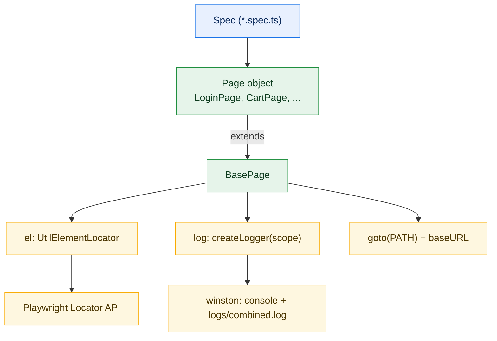
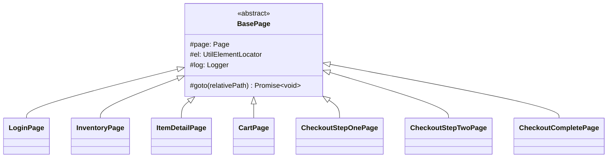
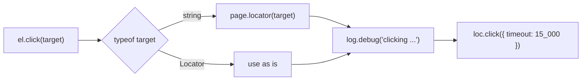
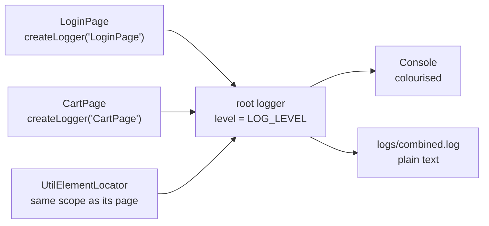
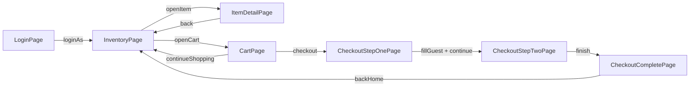

# Advance Playwright Framework 3x

An end-to-end test automation framework built on **Playwright + TypeScript**, using the Page Object Model, environment-based configuration, data-driven test utilities, and a custom HTML reporter (the TTA report) with screenshots, videos and traces for every step.

Built by [The Testing Academy](https://thetestingacademy.com).

## Tech stack

| Area | Tool |
|---|---|
| Test runner | `@playwright/test` 1.64 |
| Language | TypeScript |
| Config | `dotenv` (`.env` file) |
| Logging | `winston` (console + `logs/combined.log`) |
| Reporting | TTA custom reporter, Playwright HTML report |
| Test data | CSV, YAML, Excel (`exceljs`), MySQL (`mysql2`), `@faker-js/faker` |
| CI | GitHub Actions |

## Folder structure

```
AdvancePlaywrightFramework3x
├── src/
│   ├── ai/          → AI helpers used by the TTA report (RCA, flaky analysis)
│   ├── api/         → API clients
│   ├── config/      → Environment configuration
│   ├── fixtures/    → Custom Playwright fixtures (test-base.ts, in progress)
│   ├── pages/       → BasePage + 7 TTACart page objects (login to checkout complete)
│   ├── testdata/    → Test data files
│   ├── tests/       → Test cases (*.spec.ts), e2e/ for full user journeys
│   └── utils/       → UtilElementLocator, logger, reporter, data readers, step screenshots
├── docs/
├── rules/
├── learnings/       → Notes on non-obvious problems and how they were solved
├── .github/         → CI workflow
├── .env.example     → Template for your local .env
├── package.json
├── playwright.config.ts
└── tsconfig.json
```

## Getting started

Prerequisites: Node.js 20 or newer.

```bash
git clone https://github.com/PramodDutta/AdvancePlaywrightFramework3x.git
cd AdvancePlaywrightFramework3x

npm ci                         # install dependencies
npx playwright install         # download browsers
cp .env.example .env           # then edit .env with your values

npx playwright test            # run the suite
```

## Running tests

```bash
npx playwright test                          # all tests
npx playwright test src/tests/login.spec.ts  # one file
npx playwright test -g "valid credns"        # by test title
npx playwright test --ui                     # interactive UI mode
npx playwright test --debug                  # step through with the inspector
```

Default run settings (see [playwright.config.ts](playwright.config.ts)):

- **Browser:** Chromium at a 1920x1080 viewport. Firefox and WebKit projects are in the config, commented out.
- **Headed locally, headless on CI.** `headless: !!process.env.CI` shows the browser on your machine and keeps CI runners (which have no display) headless.
- **Media on every test:** screenshot, video and trace are all `'on'` so the report always has something to show. For a large suite, switch to `'only-on-failure'` / `'retain-on-failure'`.
- **On CI:** 2 retries, 1 worker, and `test.only` fails the build.

## Environments

The base URL is picked in `resolveBaseURL()` in the config:

1. If `BASE_URL` is set, it is used as is.
2. Otherwise `TTA_ENV` selects one of the URLs below (default `qa`).

| `TTA_ENV` | Uses |
|---|---|
| `qa` (default) | `QA_BASE_URL` |
| `stg`, `stage`, `staging` | `STG_BASE_URL` |
| `prod`, `production` | `PROD_BASE_URL` |
| `dev`, `local` | `DEV_BASE_URL` |
| `api` | `API_BASE_URL` |

To switch environments, leave `BASE_URL` empty and run, for example:

```bash
TTA_ENV=stg npx playwright test
```

### Environment variables

| Variable | Used for |
|---|---|
| `TTA_ENV`, `BASE_URL`, `*_BASE_URL` | Base URL selection (above) |
| `TEST_ENV`, `TEST_AUTHOR` | Shown in the TTA report header |
| `USERNAME`, `PASSWORD` | Login credentials for tests |
| `LOG_LEVEL` | Logging verbosity |
| `ANTHROPIC_API_KEY` / `OPENAI_API_KEY` / `GOOGLE_API_KEY` | Optional, enables the AI Verdict tab |
| `MYSQL_HOST`, `MYSQL_PORT`, `MYSQL_USER`, `MYSQL_PASSWORD`, `MYSQL_DATABASE` | Optional, MySQL data-driven tests |

> **Windows note:** Windows always sets `USERNAME` to your login name, and dotenv does not overwrite variables that already exist. On Windows, `process.env.USERNAME` will be your Windows user, not the value in `.env`.

`.env` is gitignored. Never commit real credentials.

## Reports

### TTA custom report

Generated by [src/utils/CustomReporter.ts](src/utils/CustomReporter.ts) on every run.

```bash
open tta-report/index.html        # macOS: latest run
start tta-report/index.html       # Windows
```

- `tta-report/index.html` always opens the **latest** run. `history.html` lists earlier runs.
- Each test shows its steps, logs, screenshots, video and a downloadable trace.
- The report refreshes itself every 5 seconds while tests are running.
- **Flaky tab:** compares this run with the previous one (snapshots in `reports/runs/`), so it appears from the second run onwards.
- **AI Verdict tab:** root-cause hints for failed tests, enabled when one of the AI API keys is set. The agent in [src/ai/agents/rcaAgent.ts](src/ai/agents/rcaAgent.ts) is currently heuristic; swap in a real LLM call when ready.

### Playwright HTML report

```bash
npx playwright show-report
```

### Trace viewer

```bash
npx playwright show-trace tta-report/traces/trace_1.zip
```

## Framework layers

A spec talks only to page objects. Every page object extends `BasePage`, which gives it an action wrapper (`el`), a scoped logger (`log`) and a `goto()` that resolves against `baseURL`.



### 01: BasePage

**Concept:** [BasePage](src/pages/BasePage.ts) is the abstract parent of every TTACart page object. It gives each subclass the `page`, an `el` action wrapper, a `log` tagged with the page's name, and a `goto(path)` helper that navigates relative to `baseURL`.

**Why:** Without it, every page object repeats the same constructor wiring and hard-codes full URLs, so switching environments means editing every page.

**Q&A: why use this?**
- **Q: Why doesn't BasePage build any locators?** A: Each page owns its own `private readonly` locators. The base class carries only plumbing, so it never grows into a god object.
- **Q: Why is `goto()` protected?** A: Specs call the page's `open()`, which goes to the page's static `PATH` and then runs `assertLoaded()`. Specs never pass raw URLs.
- **Q: What's the gotcha?** A: The `scope` string passed to `super(page, 'CartPage')` is what every log line is tagged with. Copy-paste a page and forget to change it, and the logs point at the wrong page.



```ts
// src/pages/BasePage.ts
export abstract class BasePage {
    protected readonly page: Page;
    protected readonly el: UtilElementLocator;
    protected readonly log: Logger;

    protected constructor(page: Page, scope: string) {
        this.page = page;
        this.el = new UtilElementLocator(page, scope);
        this.log = createLogger(scope);
    }

    protected async goto(relativePath: string): Promise<void> {
        await this.page.goto(relativePath);
        await this.page.waitForLoadState('domcontentloaded');
    }
}

// src/pages/CartPage.ts
export class CartPage extends BasePage {
    static readonly PATH = '/playwright/ttacart/cart.html';

    async open(): Promise<void> {
        await this.goto(CartPage.PATH);
        await this.assertLoaded();
    }
}
```

### 02: UtilElementLocator

**Concept:** [UtilElementLocator](src/utils/UtilElementLocator.ts) is a thin wrapper over Playwright actions (click, fill, read text, waits, selects). Every method takes a `Flex` target, either a CSS string or a `Locator`, and uses one default timeout of 15 seconds.

**Why:** It gives every action one place for logging and timeouts, so a page object writes `this.el.click(btn)` and the debug log records exactly what was clicked.

**Q&A: why use this?**
- **Q: When do I pass a string instead of a Locator?** A: Use the page's `private readonly` Locator for anything used more than once. A string such as `'[data-test="remove-tta-practice-backpack"]'` is fine for a one-off dynamic target.
- **Q: What does it replace?** A: Raw `locator.click()` / `fill()` calls scattered through page objects, each with its own timeout and no logging.
- **Q: What's the gotcha?** A: `getText()` reads `textContent`, which includes hidden text. Use `getInnerText()` when you want only what is rendered. Also, `type()` is kept as a familiar name but calls `pressSequentially()`, because Playwright deprecated `type()`.



```ts
// src/utils/UtilElementLocator.ts
export type Flex = string | Locator;

private toLocator(target: Flex): Locator {
    return typeof target === 'string' ? this.page.locator(target) : target;
}

async click(target: Flex, timeout: number = DEFAULT_ACTION_TIMEOUT_MS): Promise<void> {
    const loc = this.toLocator(target);
    this.log.debug(`clicking ${this.describe(target)}`);
    await loc.click({ timeout });
}

// src/pages/LoginPage.ts: Locators in, logged actions out
async loginAs(username: string, password: string): Promise<void> {
    this.log.info(`loginAs ${username}`);
    await this.el.fill(this.usernameInput, username);
    await this.el.fill(this.passwordInput, password);
    await this.el.click(this.loginButton);
    await expect.poll(async () => (
        this.page.url().includes('/inventory') || await this.errorBox.isVisible()
    )).toBe(true);
}
```

| Group | Methods |
|---|---|
| Clicks | `click`, `doubleClick`, `rightClick`, `hover` |
| Input | `fill`, `type`, `clear`, `pressSequentially` |
| Read | `getText`, `getInnerText`, `getAllTexts`, `getAttr`, `getValue`, `count` |
| State | `isVisible`, `isEnabled`, `isChecked` |
| Waits | `waitForVisible`, `waitForHidden`, `waitForPageLoad` |
| Selects | `selectByText`, `selectByValue`, `selectByIndex` |

### 03: Scoped logger

**Concept:** [logger.ts](src/utils/logger.ts) wraps winston. `createLogger(scope)` returns a child logger that stamps every line with its scope, so `[LoginPage]` tells you which page wrote it.

**Why:** `console.log` leaves a wall of untagged output and nothing on disk. This writes colourised console lines plus a plain-text `logs/combined.log`.

**Q&A: why use this?**
- **Q: How do I see the per-click lines?** A: Set `LOG_LEVEL=debug` in `.env`. The default `info` shows `loginAs standard_user` but hides `clicking locator(...)`.
- **Q: What does it replace?** A: Ad-hoc `console.log` calls with no timestamp, level or source.
- **Q: What's the gotcha?** A: Child loggers share the root logger's level. You can't put only `CartPage` on `debug`; `LOG_LEVEL` applies to every scope at once.



```ts
// src/utils/logger.ts
const lineFormat = printf(({ level, message, timestamp: ts, scope }) => {
    const tag = scope ? ` [${scope as string}]` : '';
    return `${ts as string} [${level}]${tag} ${message as string}`;
});

export function createLogger(scope: string): winston.Logger {
    return logger.child({ scope });
}
```

Output from a checkout run with `LOG_LEVEL=debug`:

```text
2026-10-22 07:58:05 [info] [LoginPage] loginAs standard_user
2026-10-22 07:58:05 [debug] [LoginPage] clicking locator('[data-test="login-button"]')
2026-10-22 07:58:06 [debug] [InventoryPage] clicking locator('[data-test="add-to-cart-tta-practice-backpack"]')
2026-10-22 07:58:07 [debug] [CheckoutStepOnePage] fill locator('[data-test="firstName"]')
2026-10-22 07:58:08 [debug] [CheckoutStepTwoPage] clicking locator('[data-test="finish"]')
```

### 04: TTACart page objects (checkout journey)

**Concept:** Seven page objects, one per TTACart screen. Each has a static `PATH`, private `data-test` locators, and intent-level methods such as `addToCart(id)`, `fillGuest()` and `total()`.

**Why:** A checkout test then reads like the user journey, and a selector change on any screen is fixed in exactly one file.

**Q&A: why use this?**
- **Q: How do I target a specific product?** A: By its slug. `addToCart('tta-practice-backpack')` builds `[data-test="add-to-cart-tta-practice-backpack"]`, and the same slug works for `CartPage.remove()` and `ItemDetailPage.openById()`.
- **Q: Why do `open()` and `assertLoaded()` assert?** A: So a test fails at the page that didn't load, not three steps later on a missing button.
- **Q: What's the gotcha?** A: `problem_user` clears `firstName` on the first valid submit of checkout step one. `CheckoutStepOnePage` does not hide this on purpose; specs using `problem_user` submit twice.



| Page object | `PATH` (under `/playwright/ttacart/`) | Key methods |
|---|---|---|
| [LoginPage](src/pages/LoginPage.ts) | `index.html` | `open`, `loginAs`, `waitForLoginButtonHidden` |
| [InventoryPage](src/pages/InventoryPage.ts) | `inventory.html` | `open`, `productNames`, `addToCart(id)`, `removeFromCart(id)`, `openItem(id)`, `openCart` |
| [ItemDetailPage](src/pages/ItemDetailPage.ts) | `inventory-item.html?id=` | `openById`, `name`, `price`, `addToCart`, `removeFromCart`, `back` |
| [CartPage](src/pages/CartPage.ts) | `cart.html` | `open`, `itemNamesList`, `rowCount`, `remove(id)`, `continueShopping`, `checkout` |
| [CheckoutStepOnePage](src/pages/CheckoutStepOnePage.ts) | `checkout-step-one.html` | `fillGuest`, `continue`, `cancel`, `expectErrorContains`, `firstNameValue` |
| [CheckoutStepTwoPage](src/pages/CheckoutStepTwoPage.ts) | `checkout-step-two.html` | `subtotal`, `tax`, `total`, `finish`, `cancel` |
| [CheckoutCompletePage](src/pages/CheckoutCompletePage.ts) | `checkout-complete.html` | `assertOrderComplete`, `confirmationText`, `backHome` |

The full journey, chained from these page objects. This is what [e2e-checkout.spec.ts](src/tests/e2e/e2e-checkout.spec.ts) is being built to cover (the spec, its `test-base.ts` fixture and `DataGenerators.ts` are still stubs):

```ts
test('standard_user buys the backpack', async ({ page }) => {
    const login = new LoginPage(page);
    const inventory = new InventoryPage(page);
    const cart = new CartPage(page);
    const stepOne = new CheckoutStepOnePage(page);
    const stepTwo = new CheckoutStepTwoPage(page);
    const complete = new CheckoutCompletePage(page);

    await login.open();
    await login.loginAs('standard_user', 'tta_secret');
    await inventory.assertLoaded();
    await inventory.addToCart('tta-practice-backpack');
    await inventory.openCart();
    expect(await cart.rowCount()).toBe(1);

    await cart.checkout();
    await stepOne.fillGuest({ firstName: 'Pramod', lastName: 'Dutta', postalCode: '560001' });
    await stepOne.continue();
    await stepTwo.assertLoaded();
    expect(await stepTwo.total()).toBeCloseTo((await stepTwo.subtotal()) + (await stepTwo.tax()), 2);

    await stepTwo.finish();
    await complete.assertOrderComplete();
});
```

## Writing tests

### Page Object Model

Page objects live in `src/pages/` and own their locators and actions. Tests only call page methods and assert.

```ts
import { test, expect } from '@playwright/test';
import { LoginPage } from '@pages/LoginPage';

test('Login with valid credentials', async ({ page }) => {
    const loginPage = new LoginPage(page);
    await loginPage.open();
    await loginPage.loginAs('standard_user', 'tta_secret');
    await expect(page).toHaveTitle('TTACart - Products');
});
```

The demo app (TTACart) tags elements with `data-test`, not Playwright's default `data-testid`, so page objects use `page.locator('[data-test="..."]')`. Page `PATH`s are relative, so `baseURL` (see [Environments](#environments)) decides which server the same test hits.

### Path aliases

[tsconfig.json](tsconfig.json) defines aliases so imports don't need `../../`:

```ts
import { LoginPage } from '@pages/LoginPage';
import { readCSV } from '@utils/csvReader';
```

Available: `@api`, `@config`, `@fixtures`, `@pages`, `@testdata`, `@utils`.

### Step screenshots in the report

Use `shot()` from [src/utils/stepScreenshot.ts](src/utils/stepScreenshot.ts) to pin a screenshot next to a specific `test.step` in the TTA report. The index is the 0-based step number.

```ts
import { shot } from '../utils/stepScreenshot';

await test.step('open the cart', async () => {
    await inventoryPage.openCart();
    await shot(page, 0, 'cart');
});
```

## Test data utilities

| File | What it does |
|---|---|
| [csvReader.ts](src/utils/csvReader.ts) | `readCSV(path)`, sync, returns rows as objects |
| [yamlReader.ts](src/utils/yamlReader.ts) | `readYAML(path)`, sync, so one `test()` per row can be generated |
| [excelReader.ts](src/utils/excelReader.ts) | `readExcel(path, sheet?)`, async |
| [dbReader.ts](src/utils/dbReader.ts) | `query(sql, params)` against MySQL, configured by `MYSQL_*` variables |
| [generateExcel.js](src/utils/generateExcel.js) | Creates `src/testdata/login-data.xlsx`: `node src/utils/generateExcel.js` |

Sync readers (CSV, YAML) can drive test generation at collection time. Async readers (Excel, MySQL) must be called inside a hook or test.

## CI

[.github/workflows/playwright.yml](.github/workflows/playwright.yml) runs the suite on every push and pull request to `main`/`master`: installs dependencies and browsers, runs the tests headless, and uploads the Playwright HTML report as a build artifact.

## Author

**Pramod Dutta**, [The Testing Academy](https://thetestingacademy.com)
