# Advance Playwright Framework 3x

An end-to-end test automation framework built on **Playwright + TypeScript**, using the Page Object Model, environment-based configuration, data-driven test utilities, and a custom HTML reporter (the TTA report) with screenshots, videos and traces for every step.

Built by [The Testing Academy](https://thetestingacademy.com).

## Tech stack

| Area | Tool |
|---|---|
| Test runner | `@playwright/test` 1.64 |
| Language | TypeScript |
| Config | `dotenv` (`.env` file) |
| Logging | `winston` (console + `logs/combined.log`) |
| Reporting | TTA custom reporter, Playwright HTML report |
| Test data | CSV, YAML, Excel (`exceljs`), MySQL (`mysql2`), `@faker-js/faker` |
| API assertions | `jsonpath-plus` (JSONPath), `ajv` + `ajv-formats` (JSON Schema) |
| LLM | `LLMGateway` over Groq, OpenRouter, OpenAI, Anthropic, DeepSeek (built-in `fetch`, no SDKs); `createAgent()` factory |
| Flaky detection | [DeFlaky](https://deflaky.com) CLI (`deflaky`), plus the report's build-vs-build diff |
| CI | GitHub Actions |

## Folder structure

```
AdvancePlaywrightFramework3x
├── src/
│   ├── ai/          → LLMGateway (Groq, OpenRouter, OpenAI, Claude, DeepSeek), agents/ (agentFactory + Test Data, RCA, Flaky, Self-Healer), prompts/
│   ├── api/         → BookingApi: restful-booker service object with managed auth token
│   ├── config/      → env.ts (reads .env), credentials.ts (TTACart login)
│   ├── fixtures/    → test-base.ts: page-object and login-state fixtures; booker.fixture.ts: BookingApi and token
│   ├── pages/       → BasePage + 7 TTACart page objects (login to checkout complete)
│   ├── testdata/    → Test data files (logintestdata.json: the six TTACart users; booking.data.ts: random bookings; jsonschema/: AJV schemas)
│   ├── tests/       → Test cases (*.spec.ts), e2e/ for full checkout journeys, apiTests/ for API specs, aiTests/ for LLM-backed specs
│   └── utils/       → UtilElementLocator, logger, reporter, DataGenerator, visualSteps, ApiHelper, data readers
├── docs/
├── rules/
├── learnings/       → Notes on non-obvious problems and how they were solved
├── .github/         → CI workflow
├── .env.example     → Template for your local .env
├── package.json
├── playwright.config.ts
└── tsconfig.json
```

## Getting started

Prerequisites: Node.js 20 or newer.

```bash
git clone https://github.com/PramodDutta/AdvancePlaywrightFramework3x.git
cd AdvancePlaywrightFramework3x

npm ci                         # install dependencies
npx playwright install         # download browsers
cp .env.example .env           # then edit .env with your values

npx playwright test            # run the suite
```

## Running tests

```bash
npx playwright test                          # all tests
npx playwright test src/tests/login.spec.ts  # one file
npx playwright test -g "valid credns"        # by test title
npx playwright test --ui                     # interactive UI mode
npx playwright test --debug                  # step through with the inspector

ATTACH_SCREENSHOTS=true npx playwright test src/tests/e2e   # e2e specs with step screenshots

BASE_URL=https://restful-booker.herokuapp.com npx playwright test src/tests/apiTests   # API specs

npx playwright test src/tests/aiTests --project=chromium   # LLM specs (need an LLM key in .env)
npm run flaky                                              # DeFlaky flake check, results in the Flaky tab
```

> Don't add `--reporter=...` when you want the TTA report: it replaces the reporters in `playwright.config.ts`, and the TTA report is not written.

The e2e specs in [src/tests/e2e/](src/tests/e2e/) all run the same TTACart checkout, each showing a different technique:

| Spec | Shows |
|---|---|
| [e2e-checkout.spec.ts](src/tests/e2e/e2e-checkout.spec.ts) | Page-object fixtures, login in `beforeEach` |
| [e2e-checkout-with-visualStep.spec.ts](src/tests/e2e/e2e-checkout-with-visualStep.spec.ts) | One `visualStep` per page, login included |
| [e2e-checkout_validFixture.spec.ts](src/tests/e2e/e2e-checkout_validFixture.spec.ts) | `validLogin` and `invalidLogin` state fixtures |
| [e2e-checkout_validFixture_PonyTail_Review.spec.ts](src/tests/e2e/e2e-checkout_validFixture_PonyTail_Review.spec.ts) | The validFixture spec after a readability pass |

The API specs in [src/tests/apiTests/01_restfulbooker_raw/](src/tests/apiTests/01_restfulbooker_raw/) call REST APIs directly, with no browser:

| Spec | Shows |
|---|---|
| [01_basic_ping.spec.ts](src/tests/apiTests/01_restfulbooker_raw/01_basic_ping.spec.ts) | `GET /ping` and a status check |
| [02_post_operation.spec.ts](src/tests/apiTests/01_restfulbooker_raw/02_post_operation.spec.ts) | `POST /booking` with headers and a payload |
| [03_newContext_api.spec.ts](src/tests/apiTests/01_restfulbooker_raw/03_newContext_api.spec.ts) | `request.newContext()` with its own base URL and headers |
| [04_put_operation.spec.ts](src/tests/apiTests/01_restfulbooker_raw/04_put_operation.spec.ts) | Token, then booking, then `PUT /booking/{id}` in `test.step` blocks |
| [05_crud.spec.ts](src/tests/apiTests/01_restfulbooker_raw/05_crud.spec.ts) | Token, create, update as a `test.describe.serial` flow, with the login read from `process.env` |
| [06_put_operation_negative_scenario.spec.ts](src/tests/apiTests/01_restfulbooker_raw/06_put_operation_negative_scenario.spec.ts) | PUT rejected: no token, invalid token, unknown booking id, missing field |

The specs in [src/tests/apiTests/02_restfulbooker_apiHelper/](src/tests/apiTests/02_restfulbooker_apiHelper/) make the same calls through [ApiHelper](#09-apihelper):

| Spec | Shows |
|---|---|
| [create-booking.spec.ts](src/tests/apiTests/02_restfulbooker_apiHelper/create-booking.spec.ts) | `api.post` and typed parsing, with logged `test.step` blocks |
| [update-booking.spec.ts](src/tests/apiTests/02_restfulbooker_apiHelper/update-booking.spec.ts) | Token, create, then `api.put` with a `Cookie` header |

The specs in [src/tests/apiTests/03_restfulbooker_fixture_e2e/](src/tests/apiTests/03_restfulbooker_fixture_e2e/) run the full lifecycle through [BookingApi and its fixture](#10-bookingapi-service-and-fixture):

| Spec | Shows |
|---|---|
| [booking-crud.e2e.spec.ts](src/tests/apiTests/03_restfulbooker_fixture_e2e/booking-crud.e2e.spec.ts) | Create, update, read back, delete, then confirm a 404 |
| [booking-crud.e2e_PonyTail_Review.spec.ts](src/tests/apiTests/03_restfulbooker_fixture_e2e/booking-crud.e2e_PonyTail_Review.spec.ts) | The lifecycle spec after a readability pass: one payload per test, `toEqual` on the whole booking |

The next two folders check the create-booking response in more detail:

| Spec | Shows |
|---|---|
| [04_jsonpathplus/booking-crud.e2e.spec.ts](src/tests/apiTests/04_jsonpathplus/booking-crud.e2e.spec.ts) | Each booking field read by its JSONPath, see [11](#11-jsonpath-field-checks) |
| [05_ajv_jsonschema_validator/booking-crud.e2e.spec.ts](src/tests/apiTests/05_ajv_jsonschema_validator/booking-crud.e2e.spec.ts) | The response validated against a JSON Schema with AJV, then the same JSONPath checks, see [12](#12-json-schema-validation-ajv) |

> **`npx playwright test` also picks up these specs.** The specs in `01_restfulbooker_raw/` and `02_restfulbooker_apiHelper/` mostly use relative paths such as `/booking`, so they fail unless `BASE_URL` points at restful-booker. The specs in `03_`, `04_` and `05_` do not need it, because they go through `BookingApi`, which defaults to the full restful-booker URL. See [08: Raw API tests](#08-raw-api-tests).

Default run settings (see [playwright.config.ts](playwright.config.ts)):

- **Browser:** Chromium at a 1920x1080 viewport. Firefox and WebKit projects are in the config, commented out.
- **Headed locally, headless on CI.** `headless: !!process.env.CI` shows the browser on your machine and keeps CI runners (which have no display) headless.
- **Media on every test:** screenshot, video and trace are all `'on'` so the report always has something to show. For a large suite, switch to `'only-on-failure'` / `'retain-on-failure'`.
- **On CI:** 2 retries, 1 worker, and `test.only` fails the build.

## Environments

The base URL is picked in `resolveBaseURL()` in the config:

1. If `BASE_URL` is set, it is used as is.
2. Otherwise `TTA_ENV` selects one of the URLs below (default `qa`).

| `TTA_ENV` | Uses |
|---|---|
| `qa` (default) | `QA_BASE_URL` |
| `stg`, `stage`, `staging` | `STG_BASE_URL` |
| `prod`, `production` | `PROD_BASE_URL` |
| `dev`, `local` | `DEV_BASE_URL` |
| `api` | `API_BASE_URL` |

To switch environments, leave `BASE_URL` empty and run, for example:

```bash
TTA_ENV=stg npx playwright test
```

### Environment variables

| Variable | Used for |
|---|---|
| `TTA_ENV`, `BASE_URL`, `*_BASE_URL` | Base URL selection (above) |
| `TEST_ENV`, `TEST_AUTHOR` | Shown in the TTA report header |
| `STANDARD_USER`, `TTA_SECRET` | TTACart login in [credentials.ts](src/config/credentials.ts); blank uses `standard_user` / `tta_secret` |
| `BOOKER_USERNAME`, `BOOKER_PASSWORD` | Restful Booker `/auth` login for [05_crud.spec.ts](src/tests/apiTests/01_restfulbooker_raw/05_crud.spec.ts); no default, so they must be set |
| `ATTACH_SCREENSHOTS` | `true` attaches a screenshot to every `visualStep()` |
| `CHECKOUT_FIRST_NAME`, `CHECKOUT_LAST_NAME`, `CHECKOUT_POSTAL_CODE` | Optional fixed customer for `DataGenerator.checkoutCustomerFromEnv()` |
| `LOG_LEVEL` | Logging verbosity |
| Any LLM key below | Optional, turns on the AI agents (AI Verdict, Self-Heal) |
| `DEFLAKY_API_KEY` | DeFlaky project token, used by `npm run flaky` to push to the DeFlaky dashboard |
| `LLM_PROVIDER`, `LLM_ALLOWED_PROVIDERS` | Which LLM the [LLMGateway](src/ai/LLMGateway.ts) calls, and the company allowlist |
| `GROQ_API_KEY`, `OPENROUTER_API_KEY`, `DEEPSEEK_API_KEY`, `OPENAI_API_KEY`, `ANTHROPIC_API_KEY` | LLM keys; set only the ones you use. `<PROVIDER>_MODEL` overrides the default model |
| `LLM_TIMEOUT_MS`, `LLM_MAX_RETRIES` | Optional, gateway timeout (default 60000) and retries (default 2) |
| `MYSQL_HOST`, `MYSQL_PORT`, `MYSQL_USER`, `MYSQL_PASSWORD`, `MYSQL_DATABASE` | Optional, MySQL data-driven tests |

> **Why `STANDARD_USER` and not `USERNAME`:** Windows always sets `USERNAME` to your login name, and dotenv does not overwrite variables that already exist, so a `USERNAME` in `.env` is silently ignored on Windows.

`.env` is gitignored. Never commit real credentials.

## Reports

### TTA custom report

Generated by [src/utils/CustomReporter.ts](src/utils/CustomReporter.ts) on every run.

```bash
open tta-report/index.html        # macOS: latest run
start tta-report/index.html       # Windows
```

- `tta-report/index.html` always opens the **latest** run. `history.html` lists earlier runs.
- Each test shows its steps, logs, screenshots, video and a downloadable trace.
- The report refreshes itself every 5 seconds while tests are running.
- **AI Data tab:** JSON produced by the Test Data agent during the run.
- **AI Verdict tab:** an LLM root-cause analysis for each failed test (RCA agent), with a heuristic fallback.
- **Flaky tab:** compares this run with the previous one (snapshots in `reports/runs/`), so it appears from the second run onwards. After `npm run flaky`, it also shows the DeFlaky FlakeScore and the pass rate of each test.
- **Self-Heal tab:** replacement locators for any locator failure, each verified on the live page (Self-Healer agent).

The AI tabs need an LLM key in `.env`. See [section 14](#14-ai-agent-factory-and-the-four-agents).

### Playwright HTML report

```bash
npx playwright show-report
```

### Trace viewer

```bash
npx playwright show-trace tta-report/traces/trace_1.zip
```

## Framework layers

A spec asks [test-base.ts](src/fixtures/test-base.ts) for the page objects it needs, or for a ready state such as a logged-in user. Every page object extends `BasePage`, which gives it an action wrapper (`el`), a scoped logger (`log`) and a `goto()` that resolves against `baseURL`.

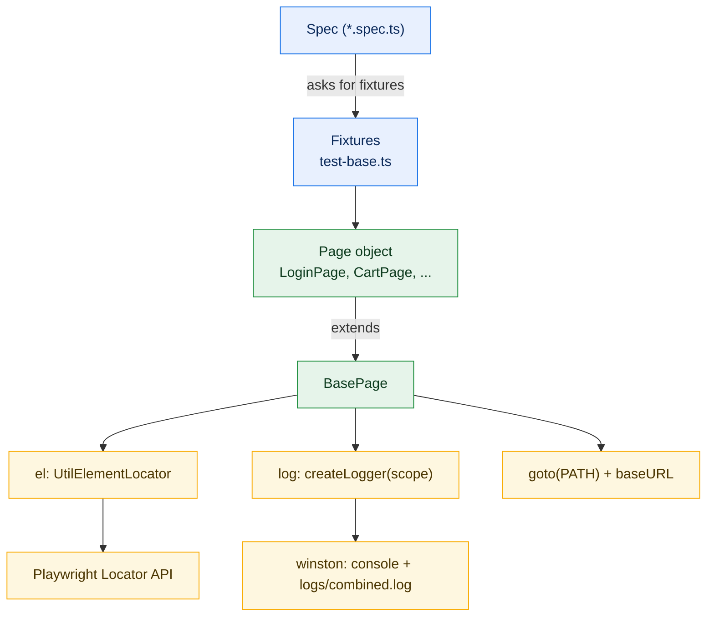

API specs take a parallel path with no browser: raw `request` calls ([08](#08-raw-api-tests)), then [ApiHelper](#09-apihelper) ([09](#09-apihelper)), then the [BookingApi service and fixture](#10-bookingapi-service-and-fixture) ([10](#10-bookingapi-service-and-fixture)). Responses are then checked field by field with [JSONPath](#11-jsonpath-field-checks) ([11](#11-jsonpath-field-checks)) and as a whole against a [JSON Schema](#12-json-schema-validation-ajv) ([12](#12-json-schema-validation-ajv)).

### 01: BasePage

**Concept:** [BasePage](src/pages/BasePage.ts) is the abstract parent of every TTACart page object. It gives each subclass the `page`, an `el` action wrapper, a `log` tagged with the page's name, and a `goto(path)` helper that navigates relative to `baseURL`.

**Why:** Without it, every page object repeats the same constructor wiring and hard-codes full URLs, so switching environments means editing every page.

**Q&A: why use this?**
- **Q: Why doesn't BasePage build any locators?** A: Each page owns its own `private readonly` locators. The base class carries only plumbing, so it never grows into a god object.
- **Q: Why is `goto()` protected?** A: Specs call the page's `open()`, which goes to the page's static `PATH` and then runs `assertLoaded()`. Specs never pass raw URLs.
- **Q: What's the gotcha?** A: The `scope` string passed to `super(page, 'CartPage')` is what every log line is tagged with. Copy-paste a page and forget to change it, and the logs point at the wrong page.

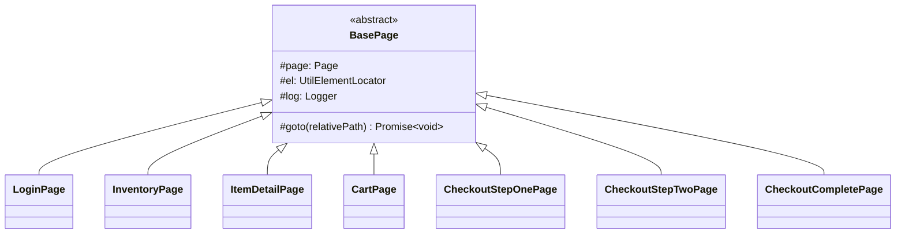

```ts
// src/pages/BasePage.ts
export abstract class BasePage {
    protected readonly page: Page;
    protected readonly el: UtilElementLocator;
    protected readonly log: Logger;

    protected constructor(page: Page, scope: string) {
        this.page = page;
        this.el = new UtilElementLocator(page, scope);
        this.log = createLogger(scope);
    }

    protected async goto(relativePath: string): Promise<void> {
        await this.page.goto(relativePath);
        await this.page.waitForLoadState('domcontentloaded');
    }
}

// src/pages/CartPage.ts
export class CartPage extends BasePage {
    static readonly PATH = '/playwright/ttacart/cart.html';

    async open(): Promise<void> {
        await this.goto(CartPage.PATH);
        await this.assertLoaded();
    }
}
```

### 02: UtilElementLocator

**Concept:** [UtilElementLocator](src/utils/UtilElementLocator.ts) is a thin wrapper over Playwright actions (click, fill, read text, waits, selects). Every method takes a `Flex` target, either a CSS string or a `Locator`, and uses one default timeout of 15 seconds.

**Why:** It gives every action one place for logging and timeouts, so a page object writes `this.el.click(btn)` and the debug log records exactly what was clicked.

**Q&A: why use this?**
- **Q: When do I pass a string instead of a Locator?** A: Use the page's `private readonly` Locator for anything used more than once. A string such as `'[data-test="remove-tta-practice-backpack"]'` is fine for a one-off dynamic target.
- **Q: What does it replace?** A: Raw `locator.click()` / `fill()` calls scattered through page objects, each with its own timeout and no logging.
- **Q: What's the gotcha?** A: `getText()` reads `textContent`, which includes hidden text. Use `getInnerText()` when you want only what is rendered. Also, `type()` is kept as a familiar name but calls `pressSequentially()`, because Playwright deprecated `type()`.

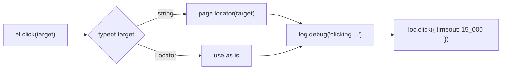

```ts
// src/utils/UtilElementLocator.ts
export type Flex = string | Locator;

private toLocator(target: Flex): Locator {
    return typeof target === 'string' ? this.page.locator(target) : target;
}

async click(target: Flex, timeout: number = DEFAULT_ACTION_TIMEOUT_MS): Promise<void> {
    const loc = this.toLocator(target);
    this.log.debug(`clicking ${this.describe(target)}`);
    await loc.click({ timeout });
}

// src/pages/LoginPage.ts: Locators in, logged actions out
async loginAs(username: string, password: string): Promise<void> {
    this.log.info(`loginAs ${username}`);
    await this.el.fill(this.usernameInput, username);
    await this.el.fill(this.passwordInput, password);
    await this.el.click(this.loginButton);
    await expect.poll(async () => (
        this.page.url().includes('/inventory') || await this.errorBox.isVisible()
    )).toBe(true);
}
```

| Group | Methods |
|---|---|
| Clicks | `click`, `doubleClick`, `rightClick`, `hover` |
| Input | `fill`, `type`, `clear`, `pressSequentially` |
| Read | `getText`, `getInnerText`, `getAllTexts`, `getAttr`, `getValue`, `count` |
| State | `isVisible`, `isEnabled`, `isChecked` |
| Waits | `waitForVisible`, `waitForHidden`, `waitForPageLoad` |
| Selects | `selectByText`, `selectByValue`, `selectByIndex` |

### 03: Scoped logger

**Concept:** [logger.ts](src/utils/logger.ts) wraps winston. `createLogger(scope)` returns a child logger that stamps every line with its scope, so `[LoginPage]` tells you which page wrote it.

**Why:** `console.log` leaves a wall of untagged output and nothing on disk. This writes colourised console lines plus a plain-text `logs/combined.log`.

**Q&A: why use this?**
- **Q: How do I see the per-click lines?** A: Set `LOG_LEVEL=debug` in `.env`. The default `info` shows `loginAs standard_user` but hides `clicking locator(...)`.
- **Q: What does it replace?** A: Ad-hoc `console.log` calls with no timestamp, level or source.
- **Q: What's the gotcha?** A: Child loggers share the root logger's level. You can't put only `CartPage` on `debug`; `LOG_LEVEL` applies to every scope at once.

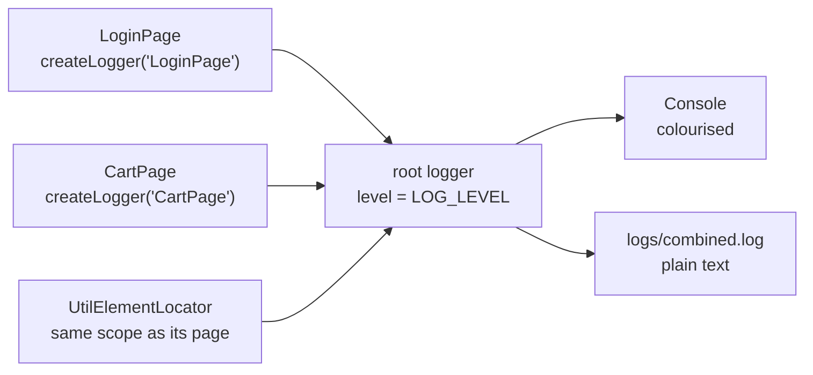

```ts
// src/utils/logger.ts
const lineFormat = printf(({ level, message, timestamp: ts, scope }) => {
    const tag = scope ? ` [${scope as string}]` : '';
    return `${ts as string} [${level}]${tag} ${message as string}`;
});

export function createLogger(scope: string): winston.Logger {
    return logger.child({ scope });
}
```

Output from a checkout run with `LOG_LEVEL=debug`:

```text
2026-10-22 07:58:05 [info] [LoginPage] loginAs standard_user
2026-10-22 07:58:05 [debug] [LoginPage] clicking locator('[data-test="login-button"]')
2026-10-22 07:58:06 [debug] [InventoryPage] clicking locator('[data-test="add-to-cart-tta-practice-backpack"]')
2026-10-22 07:58:07 [debug] [CheckoutStepOnePage] fill locator('[data-test="firstName"]')
2026-10-22 07:58:08 [debug] [CheckoutStepTwoPage] clicking locator('[data-test="finish"]')
```

### 04: TTACart page objects (checkout journey)

**Concept:** Seven page objects, one per TTACart screen. Each has a static `PATH`, private `data-test` locators, and intent-level methods such as `addToCart(id)`, `fillGuest()` and `total()`.

**Why:** A checkout test then reads like the user journey, and a selector change on any screen is fixed in exactly one file.

**Q&A: why use this?**
- **Q: How do I target a specific product?** A: By its slug. `addToCart('tta-practice-backpack')` builds `[data-test="add-to-cart-tta-practice-backpack"]`, and the same slug works for `CartPage.remove()` and `ItemDetailPage.openById()`.
- **Q: Why do `open()` and `assertLoaded()` assert?** A: So a test fails at the page that didn't load, not three steps later on a missing button.
- **Q: What's the gotcha?** A: `problem_user` clears `firstName` on the first valid submit of checkout step one. `CheckoutStepOnePage` does not hide this on purpose; specs using `problem_user` submit twice.

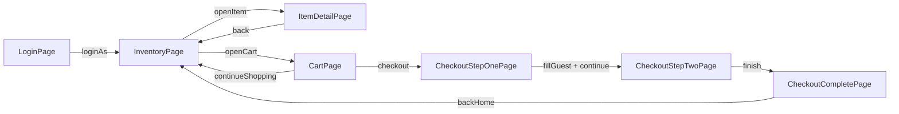

| Page object | `PATH` (under `/playwright/ttacart/`) | Key methods |
|---|---|---|
| [LoginPage](src/pages/LoginPage.ts) | `index.html` | `open`, `loginAs`, `waitForLoginButtonHidden`, `expectErrorContains` |
| [InventoryPage](src/pages/InventoryPage.ts) | `inventory.html` | `open`, `productNames`, `addToCart(id)`, `removeFromCart(id)`, `openItem(id)`, `openCart` |
| [ItemDetailPage](src/pages/ItemDetailPage.ts) | `inventory-item.html?id=` | `openById`, `name`, `price`, `addToCart`, `removeFromCart`, `back` |
| [CartPage](src/pages/CartPage.ts) | `cart.html` | `open`, `itemNamesList`, `rowCount`, `remove(id)`, `continueShopping`, `checkout` |
| [CheckoutStepOnePage](src/pages/CheckoutStepOnePage.ts) | `checkout-step-one.html` | `fillGuest`, `continue`, `cancel`, `expectErrorContains`, `firstNameValue` |
| [CheckoutStepTwoPage](src/pages/CheckoutStepTwoPage.ts) | `checkout-step-two.html` | `subtotal`, `tax`, `total`, `finish`, `cancel` |
| [CheckoutCompletePage](src/pages/CheckoutCompletePage.ts) | `checkout-complete.html` | `assertOrderComplete`, `confirmationText`, `backHome` |

The full journey, chained by hand from these page objects. The specs in [src/tests/e2e/](src/tests/e2e/) run the same journey through fixtures ([05](#05-custom-fixtures-test-basets)) and visual steps ([06](#06-visual-steps)):

```ts
test('standard_user buys the backpack', async ({ page }) => {
    const login = new LoginPage(page);
    const inventory = new InventoryPage(page);
    const cart = new CartPage(page);
    const stepOne = new CheckoutStepOnePage(page);
    const stepTwo = new CheckoutStepTwoPage(page);
    const complete = new CheckoutCompletePage(page);

    await login.open();
    await login.loginAs('standard_user', 'tta_secret');
    await inventory.assertLoaded();
    await inventory.addToCart('tta-practice-backpack');
    await inventory.openCart();
    expect(await cart.rowCount()).toBe(1);

    await cart.checkout();
    await stepOne.fillGuest({ firstName: 'Pramod', lastName: 'Dutta', postalCode: '560001' });
    await stepOne.continue();
    await stepTwo.assertLoaded();
    expect(await stepTwo.total()).toBeCloseTo((await stepTwo.subtotal()) + (await stepTwo.tax()), 2);

    await stepTwo.finish();
    await complete.assertOrderComplete();
});
```

### 05: Custom fixtures (test-base.ts)

**Concept:** [test-base.ts](src/fixtures/test-base.ts) extends Playwright's `test` with one fixture per page object plus four state fixtures (`validLogin`, `invalidLogin`, `loginWithInventory`, `loginWithSelectedItem`). A test lists what it needs in its parameters and gets it built, or set up, before the body runs.

**Why:** Specs stop repeating `new LoginPage(page)` and the same login code, and setup runs only for the tests that ask for it.

**Q&A: why use this?**
- **Q: When do I use a state fixture instead of `beforeEach`?** A: When the setup belongs to some tests in a file but not all. `validLogin` runs only for tests that list it; a `beforeEach` runs for every test in its block.
- **Q: How do the state fixtures fit together?** A: They chain. `loginWithSelectedItem` needs `loginWithInventory`, which needs `validLogin`, which needs `loginPage`. Ask for the furthest state you need and the earlier ones run first.
- **Q: What's the gotcha?** A: A fixture runs only if the test lists it. A test that needs `validLogin` just for its side effect must still list it, and the IDE greys it out as unused. Leave it there; removing it removes the login.

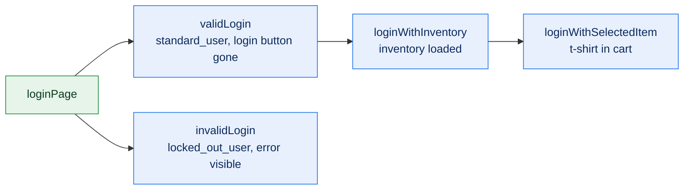

| Fixture | Gives the test | Setup it runs |
|---|---|---|
| `loginPage`, `inventoryPage`, `cartPage`, `checkoutStepOnePage`, `checkoutStepTwoPage`, `checkoutCompletePage` | A page object | None, no navigation |
| `validLogin` | `LoginPage` | Logs in as `standard_user`, waits for the login button to disappear |
| `invalidLogin` | `{ loginPage, username }` | Logs in as `locked_out_user`, waits for the error box |
| `loginWithInventory` | `InventoryPage` | `validLogin`, then asserts the inventory page loaded |
| `loginWithSelectedItem` | `{ inventoryPage, itemId }` | `loginWithInventory`, then adds `test-allthethings-tshirt-red` |

The users come from [logintestdata.json](src/testdata/logintestdata.json). `itemDetailPage` is declared in the fixture type but not registered yet, so asking for it fails at run time.

```ts
// src/fixtures/test-base.ts
validLogin: async ({ loginPage }, use) => {
    await loginPage.open();
    await loginPage.loginAs(validUser.username, validUser.password);
    await loginPage.waitForLoginButtonHidden();
    await use(loginPage);
},

// src/tests/e2e/e2e-checkout_validFixture.spec.ts
import { test, expect } from '@fixtures/test-base';

test('should reject login for a locked-out user', async ({ page, invalidLogin }) => {
    const { loginPage } = invalidLogin;   // already submitted, error already visible
    await loginPage.expectErrorContains('locked out');
    await expect(page).not.toHaveURL(/inventory/);
});
```

### 06: Visual steps

**Concept:** `visualStep(page, title, body)` from [visualSteps.ts](src/utils/visualSteps.ts) is `test.step` plus a screenshot taken when the body ends, attached under the `step-<index>-` name the TTA report pins beside that step.

**Why:** The report shows what each step left on screen, without numbering `shot(page, index, name)` calls by hand.

**Q&A: why use this?**
- **Q: How do I turn the screenshots on?** A: Set `ATTACH_SCREENSHOTS=true` in `.env`, or prefix the command with it. With `false` the steps still show in the report, just without pictures.
- **Q: What does it replace?** A: `test.step` plus `shot(page, n, name)`, where `n` is counted by hand and goes stale as soon as a step is added.
- **Q: What's the gotcha?** A: The screenshot is taken at the end of the step, so a step that ends by clicking through to the next page shows the next page. End each step on the page in its title and start the next step with the click.

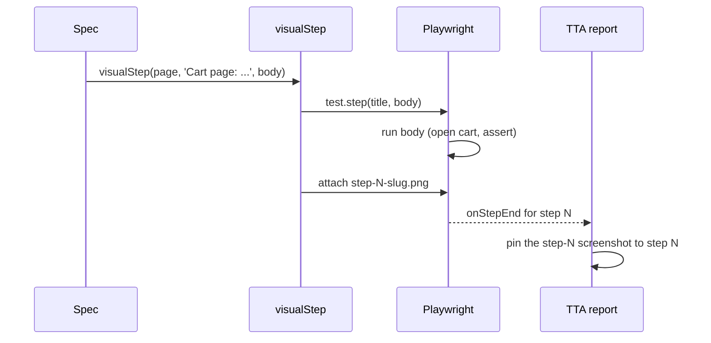

```ts
// src/tests/e2e/e2e-checkout-with-visualStep.spec.ts
// Each step ends on the page in its title, so its screenshot shows that page.
await visualStep(page, 'Cart page: verify one item in cart', async () => {
    await cartPage.open();
    expect(await cartPage.rowCount()).toBe(1);
});

await visualStep(page, 'Checkout step one: enter customer details', async () => {
    await cartPage.checkout();                     // the click that arrives here
    await checkoutStepOnePage.assertLoaded();
    await checkoutStepOnePage.fillGuest(customer);
});

await visualStep(page, 'Checkout step two: review order overview', async () => {
    await checkoutStepOnePage.continue();
    await checkoutStepTwoPage.assertLoaded();
});
```

The step index is a per-test counter, which matches the reporter's numbering only while page objects do not call `test.step` themselves.

### 07: Env config and test data

**Concept:** [env.ts](src/config/env.ts) is the one reader of `.env`: `envOr(key, fallback)` for values with a safe default, `requireEnv(key)` to fail fast, `assertEnv(...keys)` to check several at once. [credentials.ts](src/config/credentials.ts) and [DataGenerator.ts](src/utils/DataGenerator.ts) build on it.

**Why:** Missing and blank values are handled in one place, instead of `process.env.X || 'y'` scattered through specs.

**Q&A: why use this?**
- **Q: `requireEnv` or `envOr`?** A: `requireEnv` when the test means nothing without the value (an API key, a database host). `envOr` when there is a safe default, such as the TTACart demo login.
- **Q: Where does each kind of test data come from?** A: `credentials` for the standard login (`.env` first, demo default second), `logintestdata.json` for the six TTACart users the fixtures use, and `DataGenerator` for Faker customers. `checkoutCustomerFromEnv()` takes `CHECKOUT_*` values from `.env` and fakes the rest.
- **Q: What's the gotcha?** A: Faker values change every run. Keep them out of test titles: Playwright loads a spec once to collect titles and again in each worker, and different titles fail with "Test not found in the worker process".

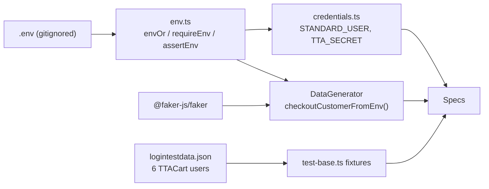

```ts
// src/config/env.ts
export function envOr(key: string, fallback: string): string {
    return read(key) ?? fallback;   // read() treats blank as unset
}

// src/config/credentials.ts
export const credentials = {
    standardUser: envOr('STANDARD_USER', 'standard_user'),
    password: envOr('TTA_SECRET', 'tta_secret'),
} as const;

// src/tests/e2e/e2e-checkout.spec.ts
await loginPage.loginAs(credentials.standardUser, credentials.password);
const customer = DataGenerator.checkoutCustomer();   // { firstName, lastName, postalCode }
await checkoutStepOnePage.fillGuest(customer);
```

### 08: Raw API tests

**Concept:** The specs in [01_restfulbooker_raw/](src/tests/apiTests/01_restfulbooker_raw/) call the restful-booker REST API through Playwright's built-in `request` fixture, with no browser, page objects or API client class.

**Why:** API calls run in about a second, and writing each request out in the spec shows exactly what is sent and what comes back.

**Q&A: why use this?**
- **Q: How do I point the specs at restful-booker?** A: Set `BASE_URL` on the command line, because the specs use relative paths such as `/booking`. `TTA_ENV=api` only works when `BASE_URL` is empty in `.env`, since `resolveBaseURL()` checks `BASE_URL` first.
- **Q: How does the token reach the PUT request?** A: `POST /auth` returns it in the response body, and the PUT sends it as a `Cookie: token=...` header. Without a valid token the API answers 403.
- **Q: What's the gotcha?** A: This API's status codes are unusual: `/ping` returns 201, and a PUT to a booking that does not exist returns 405, not 404. The specs assert what the API returns today.

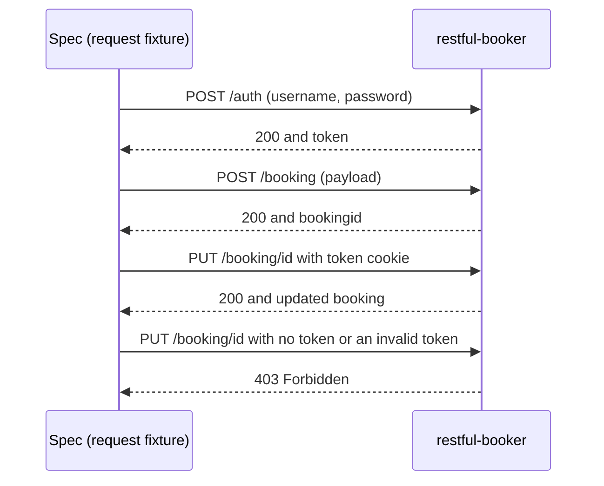

```ts
// src/tests/apiTests/01_restfulbooker_raw/04_put_operation.spec.ts
const responseData = await request.put(`/booking/${bookingId}`, {
    headers: {
        ...headers,
        Cookie: `token=${token}`,
    },
    data: payload,
});
const data = await responseData.json();
expect(data.firstname).toBe(payload.firstname);

// src/tests/apiTests/01_restfulbooker_raw/06_put_operation_negative_scenario.spec.ts
const responseData = await request.put(`/booking/${bookingId}`, {
    headers,
    data: payload,
});
expect(responseData.status()).toBe(403);
```

### 09: ApiHelper

**Concept:** [ApiHelper](src/utils/ApiHelper.ts) is a small generic class that wraps Playwright's HTTP calls behind `get`, `post`, `put`, `patch` and `delete`, with helpers to parse JSON and check the status. It knows nothing about bookings, so any spec can use it.

**Why:** Raw specs repeat the same request, status check and `response.json()` lines, and one class gives that code a single home.

**Q&A: why use this?**
- **Q: What do I pass to the constructor?** A: Either the `request` fixture or a `page`. With a `page` it sends through `page.request`, which shares the browser's cookies.
- **Q: How do I poll until the API is ready?** A: Call `callApiWithRetry(options, { condition, pollingInterval, retryCount })`. It repeats the call until `condition` returns true, by default up to 3 times, 5 seconds apart.
- **Q: What's the gotcha?** A: `callApiWithRetry` returns the last response when the condition never passes, rather than throwing, so the spec still has to assert on the result.

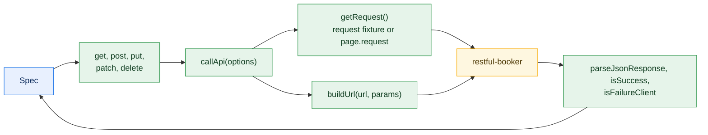

```ts
// src/tests/apiTests/02_restfulbooker_apiHelper/update-booking.spec.ts
const api = new ApiHelper(request);

const authRes = await api.post('/auth', { username: 'admin', password: 'password123' });
const { token } = await api.parseJsonResponse<{ token: string }>(authRes);

const response = await api.put(
    `/booking/${bookingid}`,
    {
        firstname: 'After',
        lastname: 'Helper',
        totalprice: 880,
        depositpaid: true,
        bookingdates: { checkin: '2026-05-02', checkout: '2026-05-09' },
        additionalneeds: 'Extra bed',
    },
    { headers: { Cookie: `token=${token}` } },
);
expect(api.isSuccess(response)).toBe(true);
```

### 10: BookingApi service and fixture

**Concept:** [BookingApi](src/api/BookingApi.ts) is a service object for restful-booker, built on `ApiHelper`, with typed methods such as `createBooking` and `updateBooking`. [booker.fixture.ts](src/fixtures/booker.fixture.ts) hands a ready instance to each test, and [booking.data.ts](src/testdata/booking.data.ts) builds random payloads through `DataGenerator`.

**Why:** Specs read as booking steps, while URLs, headers and auth tokens stay in one class.

**Q&A: why use this?**
- **Q: Do I need to pass a token?** A: No. Leave it out and `BookingApi` gets one from `/auth`, caches it, and on a 403 re-authenticates once and retries. Ask for the `bookerToken` fixture only when you want the token value itself.
- **Q: How do I test a rejected request?** A: Use a `...Response` method such as `updateBookingResponse`, which returns the raw response for you to assert on, and pass an explicit token. An explicit token goes out as-is, with no retry.
- **Q: What's the gotcha?** A: `/auth` answers bad credentials with 200 and `{ reason: "Bad credentials" }`, so `auth()` checks the body for a token. `DELETE` also returns 201, not 204.

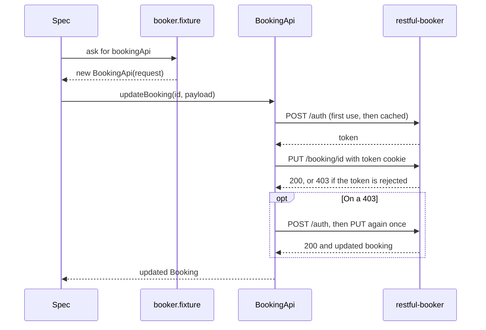

```ts
// src/tests/apiTests/03_restfulbooker_fixture_e2e/booking-crud.e2e.spec.ts
import { test, expect } from '@fixtures/booker.fixture';
import { buildBookingFromGenerator } from '@testdata/booking.data';

test.describe.serial('@e2e @P0 Level 3 - Booking lifecycle (token from fixture)', () => {
    let bookingId: number;

    test('create a booking', async ({ bookingApi }) => {
        const { bookingid, booking } = await bookingApi.createBooking(
            buildBookingFromGenerator({ firstname: 'E2E', lastname: 'Journey' }),
        );
        expect(booking.firstname).toBe('E2E');
        bookingId = bookingid;
    });

    test('update the booking, then read it back', async ({ bookingApi }) => {
        const updated = await bookingApi.updateBooking(
            bookingId,
            buildBookingFromGenerator({ firstname: 'E2E', lastname: 'Updated', totalprice: 950 }),
        );
        expect(updated).toMatchObject({ lastname: 'Updated', totalprice: 950 });
    });

    test('delete the booking and confirm it is gone', async ({ bookingApi }) => {
        expect(await bookingApi.deleteBooking(bookingId)).toBe(201); // booker returns 201, not 204
        expect((await bookingApi.getBookingResponse(bookingId)).status()).toBe(404);
    });
});
```

### 11: JSONPath field checks

**Concept:** [jsonpath-plus](https://github.com/JSONPath-Plus/JSONPath) reads a value out of JSON with a path string such as `$.booking.bookingdates.checkin`, the way XPath reads XML. The spec in [04_jsonpathplus/](src/tests/apiTests/04_jsonpathplus/) checks every field of the create-booking response by its path.

**Why:** A path names the exact field under test, which keeps assertions readable on deep, nested responses.

**Q&A: why use this?**
- **Q: Why does my path return `[]`?** A: The path starts from whatever you pass as `json`. The spec passes the whole response `{ bookingid, booking }`, so paths begin with `$.booking`. Passing `booking` itself and asking for `$.booking.firstname` finds nothing.
- **Q: Why `wrap: false`?** A: JSONPath returns an array of matches by default, so `toBe('E2E')` fails against `['E2E']`. With `wrap: false` a single match comes back as the value itself.
- **Q: When is it better than `response.booking.firstname`?** A: When the shape is deep or varies. Recursive paths such as `$..firstname` and filters such as `$.items[?(@.price > 100)]` replace loops. For one fixed field, plain property access is just as good.

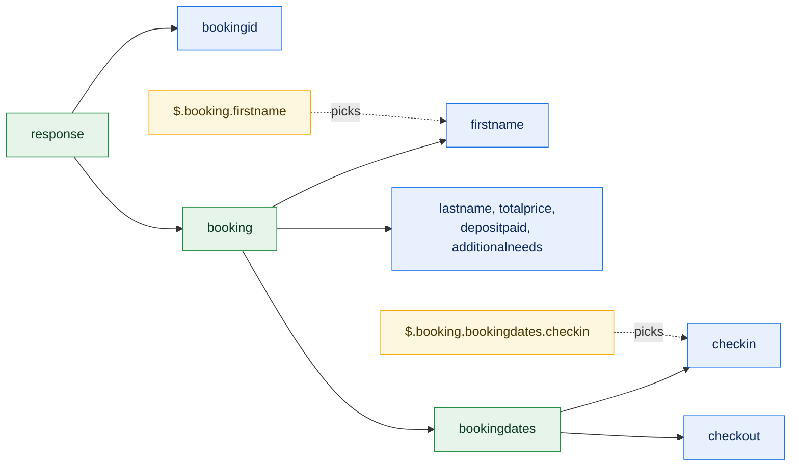

```ts
// src/tests/apiTests/04_jsonpathplus/booking-crud.e2e.spec.ts
const payload = buildBookingFromGenerator({ firstname: 'E2E', lastname: 'Journey' });
const response = await bookingApi.createBooking(payload);

const firstname = JSONPath({ path: '$.booking.firstname', json: response, wrap: false });
const totalprice = JSONPath({ path: '$.booking.totalprice', json: response, wrap: false });
const checkin = JSONPath({ path: '$.booking.bookingdates.checkin', json: response, wrap: false });

expect(firstname).toBe(payload.firstname);
expect(totalprice).toBe(payload.totalprice);
expect(checkin).toBe(payload.bookingdates.checkin);
```

### 12: JSON Schema validation (AJV)

**Concept:** [AJV](https://ajv.js.org/) checks a JSON response against a JSON Schema: which fields must exist, their types, formats such as dates, and whether extra fields are allowed. The schema lives in [src/testdata/jsonschema/create-booking.schema.json](src/testdata/jsonschema/create-booking.schema.json), apart from the spec.

**Why:** Value checks confirm that what you sent came back; a schema check also catches a changed contract, such as a renamed field or a number turned into a string, on fields you never assert on.

**Q&A: why use this?**
- **Q: What does this schema enforce?** A: `bookingid` is an integer of at least 1. `booking` has non-empty names, a numeric `totalprice`, a boolean `depositpaid`, `YYYY-MM-DD` dates and an optional `additionalneeds`, and `additionalProperties: false` rejects any field it does not list.
- **Q: Why `allErrors` and `ajv-formats`?** A: `allErrors: true` reports every broken field in one run instead of only the first. AJV 8 ships no formats, so without `ajv-formats` compiling the schema throws `unknown format "date"`.
- **Q: What's the gotcha?** A: Pass AJV's error text as the assertion message. A bare `expect(isValid).toBe(true)` fails with "expected true, received false" and no hint of which field broke.

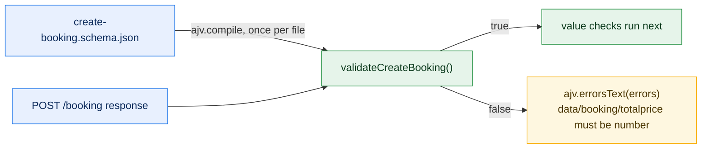

```ts
// src/tests/apiTests/05_ajv_jsonschema_validator/booking-crud.e2e.spec.ts
import Ajv from 'ajv';
import addFormats from 'ajv-formats';
import createBookingSchema from '@testdata/jsonschema/create-booking.schema.json';

const ajv = new Ajv({ allErrors: true });
addFormats(ajv);
const validateCreateBooking = ajv.compile(createBookingSchema);

// inside the test
const response = await bookingApi.createBooking(payload);
const isValid = validateCreateBooking(response);
expect(isValid, ajv.errorsText(validateCreateBooking.errors)).toBe(true);
```

A broken response fails with every problem listed at once:

```
data/booking must have required property 'lastname', data/booking must NOT have additional properties,
data/booking/totalprice must be number, data/booking/bookingdates/checkin must match format "date"
```

| Check | Catches | Use it when |
|---|---|---|
| `toEqual(payload)` | Any value that differs from what you sent | You know the whole expected object |
| JSONPath | One named field's value | The response is deep, or you only care about some fields |
| AJV schema | Missing or extra fields, wrong types, bad formats | You want to guard the contract, including fields you never assert on |

### 13: LLM Gateway and AI test data

**Concept:** [LLMGateway.ts](src/ai/LLMGateway.ts) is one class that sends a prompt to whichever LLM provider your company allows (Groq, OpenRouter, OpenAI, Anthropic Claude or DeepSeek) and gives back parsed JSON, or writes it to a file. [DataGenerator.checkoutCustomerAI()](src/utils/DataGenerator.ts) uses it to create the checkout customer in [e2e-checkout_DataGenAI.spec.ts](src/tests/aiTests/e2e-checkout_DataGenAI.spec.ts), with its prompt kept in [src/ai/prompts/](src/ai/prompts/checkoutCustomer.prompt.md).

**Why:** Teams get approval for different providers, so a test should ask for "an LLM" and let `.env` decide which one, instead of each test speaking one vendor's API.

**Q&A: why use this?**
- **Q: How do I pick a provider?** A: Set `LLM_PROVIDER=groq` (or `openrouter`, `openai`, `anthropic`, `deepseek`) and its `*_API_KEY`. With `LLM_PROVIDER` empty, the first provider that has a key is used, free ones first. `LLM_ALLOWED_PROVIDERS=groq,openrouter` makes the gateway refuse any provider your company has not approved.
- **Q: What if the model wraps the JSON in markdown or adds a sentence?** A: `askJson()` asks for JSON only, uses the provider's JSON mode where it is reliable, and then pulls the first valid JSON block out of the reply. If there is none, it throws `LLMGatewayError` with the raw reply attached.
- **Q: What's the gotcha?** A: The same prompt gives the same answer, even at temperature 1: three calls once returned "Marisol, 63108" every time. The prompt has `{{FIRST_INITIAL}}`, `{{LAST_INITIAL}}` and `{{STATE}}` placeholders that Faker fills in before each call, so every customer is different. Also, the checkout test now fails if the LLM is unreachable; use `DataGenerator.checkoutCustomer()` where that is not acceptable.

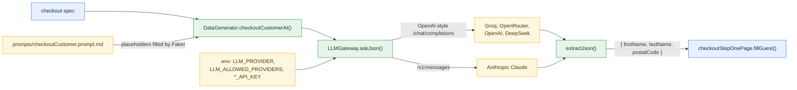

```ts
// src/utils/DataGenerator.ts (the agent itself is in section 14)
static async checkoutCustomerAI(): Promise<CheckoutCustomer> {
    // Random placeholders stop the model returning the same person on every call.
    const { firstName, lastName, postalCode } = await checkoutCustomerAgent.run({
        FIRST_INITIAL: faker.string.alpha({ casing: 'upper' }),
        LAST_INITIAL: faker.string.alpha({ casing: 'upper' }),
        STATE: faker.location.state(),
    });
    return { firstName, lastName, postalCode };
}

// src/tests/aiTests/e2e-checkout_DataGenAI.spec.ts
await checkoutStepOnePage.fillGuest(await DataGenerator.checkoutCustomerAI());

// Anywhere else: JSON back, or straight to a file
const llm = new LLMGateway();                         // or new LLMGateway({ provider: 'groq' })
const { data } = await llm.askJson<{ cases: string[] }>('Give 3 negative login test cases as {"cases": [...]}');
await llm.askJsonToFile('...prompt...', 'reports/ai/login-cases.json');
```

| Provider | `LLM_PROVIDER` | Key | Default model | Cost |
|---|---|---|---|---|
| Groq | `groq` | `GROQ_API_KEY` | `llama-3.3-70b-versatile` | Free tier |
| OpenRouter | `openrouter` | `OPENROUTER_API_KEY` | `meta-llama/llama-3.3-70b-instruct:free` | Free `:free` models |
| DeepSeek | `deepseek` | `DEEPSEEK_API_KEY` | `deepseek-chat` | Paid, low cost |
| OpenAI | `openai` | `OPENAI_API_KEY` | `gpt-4o-mini` | Paid |
| Anthropic | `anthropic` | `ANTHROPIC_API_KEY` | `claude-haiku-5-5` | Paid |

Override any model with `<PROVIDER>_MODEL`, for example `GROQ_MODEL=...`.

### 14: AI agent factory and the four agents

**Concept:** [agentFactory.ts](src/ai/agents/agentFactory.ts) turns **a prompt file plus a JSON Schema** into an AI agent. `createAgent({ name, prompt, schema })` returns an agent whose `run(vars)` fills the prompt's `{{PLACEHOLDERS}}`, calls the [LLMGateway](src/ai/LLMGateway.ts), validates the reply with AJV and returns typed data. Four agents are built on it: **Test Data**, **RCA**, **Flaky** and **Self-Healer**, and each one feeds a tab of the TTA report.

**Why:** Without a factory, every agent re-implements prompt loading, JSON parsing, validation and report wiring. With it, a new agent is about 20 lines, and every agent behaves the same way: same provider rules, same validation, same error handling.

**Q&A: why use this?**
- **Q: How do I add a new agent?** A: Write `src/ai/prompts/<name>.prompt.md` with `{{VARS}}`, then call `createAgent({ name, prompt, schema })` in `src/ai/agents/<name>Agent.ts`. The factory adds the schema to the system prompt, so the model is told the exact output shape. Set `attachAs: '<attachment-name>'` to make the output appear on the running test (that is how the AI Data and Self-Heal tabs get their data).
- **Q: What if the model returns something wrong?** A: `run()` throws if a `{{VAR}}` is missing or the reply breaks the schema, showing the AJV error and the raw JSON. Agents that run inside the reporter (RCA) catch that and fall back to a heuristic, so the report never breaks. Agents that run inside a test (Test Data) let the test fail, so a broken AI step is visible.
- **Q: What's the gotcha?** A: The TTA report is only written when its reporter runs. `npx playwright test --reporter=line` **replaces** the reporters in `playwright.config.ts`, so the AI tabs keep showing an old run. Run without `--reporter`, and check the run ID in the report header.

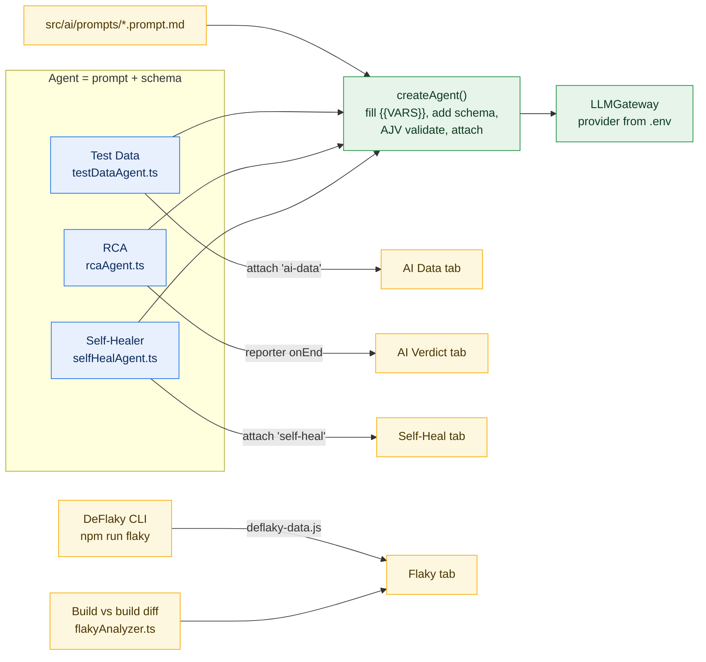

```ts
// src/ai/agents/rcaAgent.ts: a whole agent is one createAgent() call
export const rcaAgent = createAgent<RcaVerdict>({
    name: 'rca',
    prompt: 'rca.prompt.md',            // uses {{TITLE}}, {{FILE}}, {{ERROR}}, {{STACK}}
    system: 'You are a senior SDET who debugs Playwright test failures.',
    temperature: 0,
    schema: {
        type: 'object',
        required: ['rootCause', 'severity', 'priority', 'fixes'],
        properties: {
            rootCause: { type: 'string', minLength: 1 },
            severity: { enum: ['low', 'medium', 'high'] },
            priority: { enum: ['P0', 'P1', 'P2', 'P3'] },
            fixes: { type: 'array', items: { type: 'string' } },
        },
    },
});

// Calling it
const verdict = await rcaAgent.run({ TITLE: t.fullTitle, FILE: t.location, ERROR: t.error, STACK: t.errorStack });
```

| Agent | Files | When it runs | Output | Report tab | Demo spec |
|---|---|---|---|---|---|
| **Test Data** | [testDataAgent.ts](src/ai/agents/testDataAgent.ts), [checkoutCustomer.prompt.md](src/ai/prompts/checkoutCustomer.prompt.md) | Inside the test: `DataGenerator.checkoutCustomerAI()` | `{ firstName, lastName, postalCode }`, attached as `ai-data` | AI Data | [e2e-checkout_DataGenAI.spec.ts](src/tests/aiTests/e2e-checkout_DataGenAI.spec.ts) |
| **RCA** | [rcaAgent.ts](src/ai/agents/rcaAgent.ts), [rca.prompt.md](src/ai/prompts/rca.prompt.md) | Reporter `onEnd`, for each failed test (max 10) | `RcaVerdict { rootCause, severity, priority, fixes[] }`; heuristic fallback if the LLM fails | AI Verdict | [e2e-checkout-failure.spec.ts](src/tests/aiTests/e2e-checkout-failure.spec.ts) (one deliberate failure) |
| **Flaky** | [flakyAnalyzer.ts](src/ai/agents/flakyAnalyzer.ts), [deflakyRun.js](src/utils/deflakyRun.js) | Every run (build vs previous build) + `npm run flaky` (DeFlaky, N runs) | Flaky/failing lists; DeFlaky FlakeScore and per-test pass rate | Flaky | [e2e-checkout-flaky.spec.ts](src/tests/aiTests/e2e-checkout-flaky.spec.ts) (one deliberate flake) |
| **Self-Healer** | [selfHealAgent.ts](src/ai/agents/selfHealAgent.ts), [selfHeal.prompt.md](src/ai/prompts/selfHeal.prompt.md) | Auto `selfHealer` fixture in [test-base.ts](src/fixtures/test-base.ts), after a test fails on a locator | Replacement locators, each verified on the live page (1 match, visible), attached as `self-heal` | Self-Heal | [e2e-checkout-selfheal.spec.ts](src/tests/aiTests/e2e-checkout-selfheal.spec.ts) (stale `[data-test="checkout-button"]`) |

**How each agent works:**
- **Test Data:** the prompt has `{{FIRST_INITIAL}}`, `{{LAST_INITIAL}}` and `{{STATE}}` placeholders filled by Faker. Without them, the same prompt returned the same person every time. The schema requires a 5-digit `postalCode`.
- **RCA:** the reporter's existing `analyzeFailure()` now calls `rcaAgent`. It is turned on by `hasApiKey()` in [providers.ts](src/ai/config/providers.ts), which now accepts any key the gateway supports.
- **Flaky:** the report already compared this build with the previous one. [DeFlaky](https://deflaky.com) adds a FlakeScore over N runs: `npm run flaky` runs the spec through the `deflaky` CLI, pushes to the DeFlaky dashboard, then copies `.deflaky/last-run.json` to `tta-report/deflaky-data.js`, which the Flaky tab renders. A wrapper is needed because DeFlaky writes its results only after all runs end, and the TTA report is written during the last run. Playwright also has to write a JSON report (`test-results/results.json`) for DeFlaky to read.
- **Self-Healer:** after a failure, it reads the dead locator from Playwright's call log (`waiting for locator(...)`). It captures the visible interactive elements of the failing page as compact JSON, not raw HTML, and asks for `page.locator()` selector strings so each one can be checked automatically. The test still fails: the healer only suggests, and never rewrites code.

```bash
npx playwright test src/tests/aiTests --project=chromium   # all AI demos (2 tests fail on purpose)
npm run flaky                                              # DeFlaky: 2 runs, push, add to the Flaky tab
npm run flaky -- src/tests/aiTests/e2e-checkout-flaky.spec.ts 5
open tta-report/index.html
```

Full design notes: [learnings/2026-11-14-ai-agent-factory-plan.md](learnings/2026-11-14-ai-agent-factory-plan.md). DeFlaky commands: [learnings/2026-11-14-deflaky-commands.md](learnings/2026-11-14-deflaky-commands.md).

## Writing tests

### Page Object Model

Page objects live in `src/pages/` and own their locators and actions. Tests only call page methods and assert.

```ts
import { test, expect } from '@playwright/test';
import { LoginPage } from '@pages/LoginPage';

test('Login with valid credentials', async ({ page }) => {
    const loginPage = new LoginPage(page);
    await loginPage.open();
    await loginPage.loginAs('standard_user', 'tta_secret');
    await expect(page).toHaveTitle('TTACart - Products');
});
```

The demo app (TTACart) tags elements with `data-test`, not Playwright's default `data-testid`, so page objects use `page.locator('[data-test="..."]')`. Page `PATH`s are relative, so `baseURL` (see [Environments](#environments)) decides which server the same test hits.

### Path aliases

[tsconfig.json](tsconfig.json) defines aliases so imports don't need `../../`:

```ts
import { LoginPage } from '@pages/LoginPage';
import { readCSV } from '@utils/csvReader';
```

Available: `@api`, `@config`, `@fixtures`, `@pages`, `@testdata`, `@utils`.

### Step screenshots in the report

For a screenshot on every step, use `visualStep()` (see [06](#06-visual-steps)). To pin one screenshot to a plain `test.step`, use `shot()` from [src/utils/stepScreenshot.ts](src/utils/stepScreenshot.ts). The index is the 0-based step number.

```ts
import { shot } from '../utils/stepScreenshot';

await test.step('open the cart', async () => {
    await inventoryPage.openCart();
    await shot(page, 0, 'cart');
});
```

## Test data utilities

| File | What it does |
|---|---|
| [csvReader.ts](src/utils/csvReader.ts) | `readCSV(path)`, sync, returns rows as objects |
| [yamlReader.ts](src/utils/yamlReader.ts) | `readYAML(path)`, sync, so one `test()` per row can be generated |
| [excelReader.ts](src/utils/excelReader.ts) | `readExcel(path, sheet?)`, async |
| [dbReader.ts](src/utils/dbReader.ts) | `query(sql, params)` against MySQL, configured by `MYSQL_*` variables |
| [generateExcel.js](src/utils/generateExcel.js) | Creates `src/testdata/login-data.xlsx`: `node src/utils/generateExcel.js` |

Sync readers (CSV, YAML) can drive test generation at collection time. Async readers (Excel, MySQL) must be called inside a hook or test.

## CI

[.github/workflows/playwright.yml](.github/workflows/playwright.yml) runs the suite on every push and pull request to `main`/`master`: installs dependencies and browsers, runs the tests headless, and uploads the Playwright HTML report as a build artifact.

## Author

**Pramod Dutta**, [The Testing Academy](https://thetestingacademy.com)
